# Visa Inc. (NYSE: V): Investment Report

**Analysis date: 17 October 2026.** Market prices are closes on Friday 16 October 2026 unless stated otherwise. The latest company data is fiscal Q3 2026, the quarter to 30 June 2026 (10-Q filed 28 July 2026 [V10Q26Q3]). The latest audited year is FY2025, the year to 30 September 2025 (10-K filed 6 November 2025 [V10K25]). **Visa reports its fiscal Q4 and full-year 2026 results on 27 October 2026, ten days after this report** [VQ4DATE]. Several numbers below will need refreshing then.

> **This is not personal financial advice.** It is an analytical report written to support your own decision. It does not know your full financial situation, tax position or risk tolerance, and it may contain errors. Check anything decisive against the primary sources before you act.

**Your situation, as I have understood it:** you are based in Norway and invest in NOK. Your horizon is 10–20 years and you are considering NOK 30,000–50,000. The alternative is a low-cost global index fund. You did not state the size of your total portfolio, so position sizing is shown for several portfolio sizes in Section 11.

**How to read this report.** Claims are tagged:

- **[F] Fact:** taken from a cited source, with its date.
- **[E] Estimate:** produced by the Python scripts in `analysis/` from stated assumptions.
- **[J] Judgment:** my opinion.

Sources are cited inline by short code, e.g. [V10K25], and listed in full at the end.

**Data note.** The sandbox this was produced in blocked direct downloads from SEC EDGAR, FRED, Norges Bank and Visa's IR site.

- **How the figures were collected:** each figure was transcribed from the cited primary filing using a web-search tool and recorded one by one with its source in `analysis/data/visa_annual.csv`. All 31 internal consistency checks in `analysis/output/consistency_checks.csv` pass. The checks confirm that revenue lines add up to reported net revenue, that expense lines add up to total operating expenses, that net income ÷ EPS reproduces the reported share count, and that assets minus liabilities equals equity.
- **Secondary sources:** a minority of older cash-flow and balance-sheet items come from compilers of SEC data (Macrotrends, finboard, equibles, stockanalysis). These are flagged in the data file.
- **Market history:** FX rates, CPI, 10-year yields and S&P 500 history come from public mirrors of Federal Reserve/FRED, BLS and Robert Shiller data.
- **Verification:** `analysis/verify_with_sec_xbrl.py` re-checks the compiled figures against SEC XBRL data. It needs normal internet access and could not be run in the sandbox.

---

## 1. Executive summary

### Recommendation: **HOLD/WAIT.** Don't buy at $402.61. Become a buyer at or below about **$345** (≈23× FY2027 consensus EPS).
### Confidence: **Medium**

**Key reasons**

1. **The business is exceptional [F].** In FY2025:
   - Net revenue was $40.0bn, with a GAAP operating margin of 60% (68% non-GAAP).
   - Free cash flow was $21.6bn, and capex only 3.7% of revenue.
   - Return on invested capital was 32% (46% net of cash).

   Visa carries no consumer credit risk; it charges a small toll on payment flows. Over FY2015–25, net revenue compounded at 11.2% a year and non-GAAP EPS at 15.9% [V10K25, V10K22, V10K19].
2. **The price already pays for most of that [F][E].**
   - **Multiples:** 34.3× trailing GAAP EPS, 31.5× non-GAAP, 26.9× FY2027 consensus.
   - **Cash yield vs bonds:** the free-cash-flow yield is 2.75%, against a 5.08% US 10-year Treasury. That is the widest negative gap in the 11 fiscal year-ends examined.
   - **Reverse DCF:** today's price implies about 9.3% annual revenue growth for FY2027–31 (≈7.7% a year over ten years) at an 8.5% discount rate.
   - **Base-case DCF:** $419 (+4%), but moving the discount rate ±0.5 percentage points (pp) shifts it to $376–$472.
3. **The expected return is about the same as the index, with more risk [E][J].** With a 25% bear, 50% base and 25% bull weighting, the probability-weighted return is **8.6%/yr over 5 years** and **8.4%/yr over 10 years** in USD. A global index fund is expected to return roughly 7–9.3%, and it already holds Visa (about 0.57% of MSCI ACWI [MSCI]). You would not be paid for taking concentrated single-stock risk.
4. **Pressure is building on several fronts at once [F].**
   - **US merchant settlement:** preliminary approval came on 9 Jun 2026, and the fairness hearing is reportedly on 16 Nov 2026. It relaxes "honor all cards" and lets merchants surcharge [PD-MDL, MCAG].
   - **Legislation:** the Credit Card Competition Act has the President's endorsement [CCCA].
   - **DOJ debit case:** heading for trial around 2028 [PD-DOJ].
   - **UK/EU:** fee caps and investigations [PSR, EC].
   - **Issuer networks:** Capital One is moving cards onto its own Discover network [CAPONE].
   - **Government-backed rails:** Pix and UPI are winning in big emerging markets [PIX, UPI].

   None of these is fatal on its own; together they argue for a margin of safety [J].
5. **Timing [F][J].** The shares rose about 12% in the 12 trading days to 16 October, from $360.12 to a record $402.61 [MKTBEAT, MORN]. The triggers were a Chinese clearing-licence approval, stablecoin news and analyst upgrades [RALLY, TRADINGKEY], ten days before full-year results. Nothing in that news adds 12% to ten-year value.

**The single biggest risk** is a slow erosion of Visa's pricing power. It could come from US rules on routing and merchant steering (the CCCA, the DOJ case, the settlement terms) and from state-sponsored account-to-account rails abroad. The current price leaves little room for growth below about 9% a year.

| Key figure | Value | Date / type |
|---|---|---|
| Share price | $402.61 | 16 Oct 2026 [F] |
| Market cap (1,895m diluted shares) | ≈ $763bn | [E] |
| Net revenue FY2025 / trailing 12 months (TTM) to Jun 2026 | $40.0bn / $44.5bn | [F] / [E] |
| Non-GAAP EPS FY2025 / TTM / FY2027E consensus | $11.47 / $12.77 / $14.94 | [F] / [E] / [F] |
| P/E: trailing GAAP, trailing non-GAAP, FY2027E | 34.3× / 31.5× / 26.9× | [E] |
| FCF yield (TTM) vs US 10-year Treasury | 2.75% vs 5.08% | [E] / [F] |
| DCF value per share (base case) | $419 (range $376–$472 at 9.0%–8.0% discount rate) | [E] |
| Probability-weighted expected return, USD | 8.6%/yr (5 yrs), 8.4%/yr (10 yrs) | [E] |
| "Buy-below" price for a ≈10%/yr expected 10-year return | ≈ $345 | [E] |

---

## 2. Business model and economics

### 2.1 How Visa makes money

Visa runs a four-party network:

1. A cardholder pays a merchant.
2. The merchant's bank (the acquirer) sends the transaction over VisaNet to the cardholder's bank (the issuer).
3. Visa authorises, clears and settles the transaction between the two banks.

Visa charges fees to both banks. It does **not** receive the interchange fee the merchant pays the issuer, and it does not set the consumer's interest rate. Its gross revenue comes in four lines, and it then pays back "client incentives" to banks and merchants [V10K25]:

| Revenue line, FY2025 | USD m | % of gross | Main driver | CAGR FY15–25 |
|---|---:|---:|---|---:|
| Service revenue | 17,539 | 31.5% | Payments volume (recognised on the *prior* quarter's volume) [VER19Q4] | 10.8% |
| Data processing revenue | 19,993 | 35.9% | Number of processed transactions, plus pricing [V10K25] | 13.7% |
| International transaction revenue | 14,166 | 25.4% | Cross-border volume (+13% ex intra-Europe in FY2025) and currency volatility [V10K25] | 13.3% |
| Other revenue | 4,053 | 7.3% | Value-added services, licensing, other fees | 17.3% |
| **Gross revenue** | **55,751** | 100% | | 12.8% |
| Client incentives (contra-revenue) | (15,751) | 28.3% of gross | Contracts paying issuers/merchants for volume and exclusivity | 18.6% |
| **Net revenue** | **40,000** | | | **11.2%** |

*Source: [V10K25] (FY2023–25), [V10K22] (FY2020–22), [V10K19] (FY2017–19), [VER16Q4] (FY2015–16); computed in `financials.py`. FY2015–16 incentives are derived as gross minus net revenue [E].*

Other FY2025 facts [F]:

- **Volumes:** about $14.2 trillion of payments volume, 257.5 billion processed transactions (+10%), and cross-border volume ex intra-Europe +13% in constant dollars [V10K25, VER25Q4].
- **Value-added services:** Visa separately reports VAS revenue (fraud/risk, issuing and acceptance solutions, advisory) of **$10.9bn, +24%**, up from $7.2bn in FY2023 [V10K25]. It is larger than "other revenue", so it must be booked across several lines [J].
- **Geography:** about **61% of net revenue is earned outside the US** (US ≈ 39%). One client accounts for 11% of net revenue [V10K25].

[E] Visa earns about **15.5 cents of net revenue per processed transaction**. That ratio has stayed between 14.6 and 18.1 cents since FY2016, even as volumes more than tripled. Visa's take is a small, stable toll per transaction.

### 2.2 A network, not a lender

- **Who carries the credit risk [F].** Card-issuing banks extend the credit, set the interest rates and absorb consumer defaults. Visa has no loan book and no deposit funding, so it has no credit losses and no net-interest-margin cycle.
- **Visa's only balance-sheet risk is settlement [F].** Visa guarantees that a bank will be paid if another bank fails to fund its settlement obligations. In FY2025, the maximum daily settlement exposure was **$153.4bn** (average $91.2bn), backed by **$8.8bn of collateral**. Visa says historical losses have been minimal [V10K25-R22].
- **What this means.** Revenue depends on spending volume, not on lending spreads. That is why Visa grew revenue by about 10% in the 2009 recession while banks took large loan losses (Section 6.7). It also means capital needs are minimal; Visa's tangible capital is actually negative (Section 3.5). The flip side is dependence on a concentrated group of large issuers, which can bargain hard for incentives or, like Capital One, take volume to their own network [J].

### 2.3 Network effects, scale and operating leverage

- **Two-sided network effect [J].** Cardholders want the card accepted everywhere, and merchants accept it because cardholders carry it. Each side makes the other more valuable, so a rival needs both sides at once to compete. That is extremely hard to replicate globally, which is why the same few networks have dominated for decades. On the industry-wide count, Visa handled **40.8% of all card purchase transactions worldwide in 2025**, and **70.4% of US Visa+Mastercard purchase volume** [NILSON, NILSON-US].
- **Scale economics [F][E].** Network and processing costs were $894m in FY2025, about 2.2% of net revenue, against $40bn of revenue [V10K25]. The marginal cost of one more transaction is close to zero. The largest cost lines are people ($7.0bn) and marketing ($1.7bn).
- **Why margins are so high, and whether they can rise further.** The GAAP operating margin has been roughly 63–66% in "clean" years. The exceptions are FY2016, hit by the $1.9bn Visa Europe Framework Agreement loss [VER16Q3], and FY2025, hit by a $2.6bn litigation provision [V10K25]. The non-GAAP operating margin was 67.9%, 67.7% and 67.7% in FY2023–25 [E].
- **The margin is no longer expanding [J].** Operating leverage has largely been reinvested in people and new products. Future EPS growth will mostly have to come from revenue growth plus buybacks.

### 2.4 How durable is the moat, and what would break it?

[J] **Durable, but under slow attack from several directions.** The moat rests on global two-sided acceptance, issuer relationships, tokenisation and fraud data, a trusted brand, and decades of embedded infrastructure. Four things could break it:

1. **A cheaper rail with universal acceptance and a sponsor willing to subsidise it**, typically a central bank. Brazil's Pix is the clearest example: about 42% of Brazilian online purchases in 2025, edging past credit cards at 41% [PIX].
2. **Rules forcing routing competition and merchant steering**, such as the CCCA, a DOJ remedy, or surcharging and honor-all-cards changes. Network choice would move from the consumer or issuer to the merchant [CCCA, PD-MDL].
3. **Issuers taking volume in-house.** Capital One completed moving about 25m debit cards to Discover in July 2026 and began issuing some core credit cards on Discover instead of Visa [CAPONE].
4. **Wallets and AI agents choosing the cheapest rail for the user** in the background (Section 4).

Each is real but gradual. In most of the scenarios I consider, the result is slower growth and lower take-rates, not collapse.

---

## 3. Financial analysis (FY2015–FY2025, plus the latest 12 months)

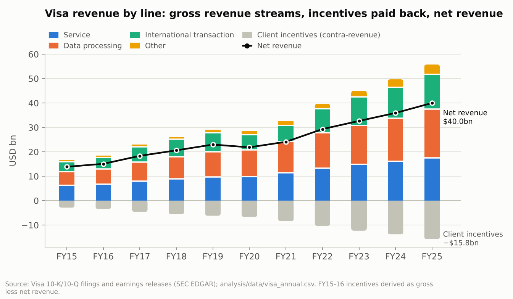

### 3.1 Revenue growth by line, and the volume drivers

| Fiscal year (to 30 Sep) | Net revenue, USD m | Growth | Service | Data processing | International | Other | Incentives % gross | Processed tx (bn) |
|---|---:|---:|---:|---:|---:|---:|---:|---:|
| FY2015 | 13,880 | – | 6,302 | 5,552 | 4,064 | 823 | 17.1% | n/a |
| FY2016 | 15,082 | 8.7% | 6,747 | 6,272 | 4,649 | 823 | 18.4% | 83.2 |
| FY2017 | 18,358 | 21.7% | 7,975 | 7,786 | 6,321 | 841 | 19.9% | 111.2 |
| FY2018 | 20,609 | 12.3% | 8,918 | 9,027 | 7,211 | 944 | 21.0% | 124.3 |
| FY2019 | 22,977 | 11.5% | 9,700 | 10,333 | 7,804 | 1,313 | 21.2% | 138.3 |
| FY2020 | 21,846 | −4.9% | 9,804 | 10,975 | 6,299 | 1,432 | 23.4% | 140.8* |
| FY2021 | 24,105 | 10.3% | 11,475 | 12,792 | 6,530 | 1,675 | 25.8% | 164.7 |
| FY2022 | 29,310 | 21.6% | 13,361 | 14,438 | 9,815 | 1,991 | 26.0% | 192.5 |
| FY2023 | 32,653 | 11.4% | 14,826 | 16,007 | 11,638 | 2,479 | 27.4% | 212.6 |
| FY2024 | 35,926 | 10.0% | 16,114 | 17,714 | 12,665 | 3,197 | 27.7% | 233.8 |
| FY2025 | 40,000 | 11.3% | 17,539 | 19,993 | 14,166 | 4,053 | 28.3% | 257.5 |

*[F] Sources as in 2.1 plus [V10K16, V10K18, V10K19, V10K21, VAR24, VER25Q4] for transactions. \*FY2020 transactions are from a secondary source only [FW]. FY2016–17 growth is inflated by consolidating Visa Europe from 21 June 2016 (acquired for up to €21.2bn [VEUROPE]). FY2019 includes ≈3.2pp from adopting the ASC 606 revenue standard [VER19Q4]. FY2022 benefits from the reopening of travel.*

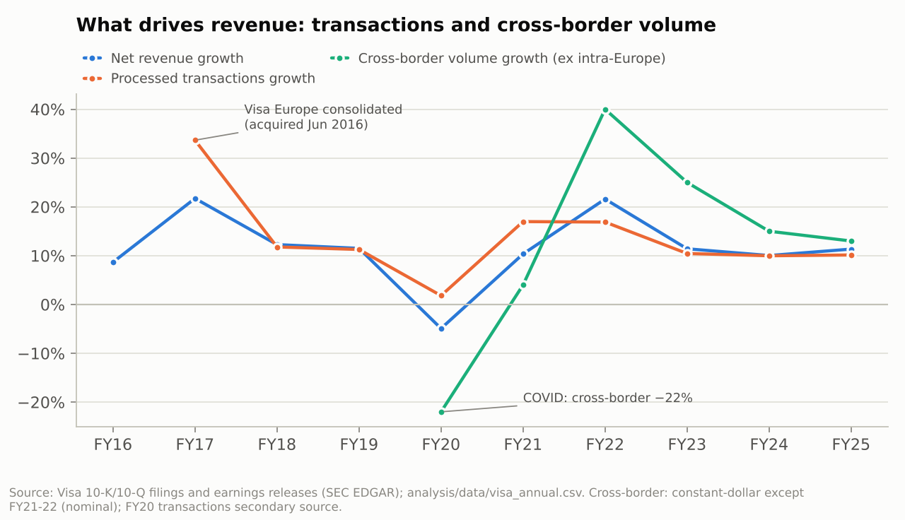

- **Through the cycle [F][E].** Net revenue grew 10–12% in "normal" years. Since the Visa Europe deal (FY2017–25) the CAGR is **10.2%**, and processed transactions grew **11.1%** a year.
- **The swing factor is cross-border volume [F].** It fell 22% in FY2020 and rose about 40% (nominal) in FY2022 as travel reopened. Constant-dollar growth was +25% in FY2023, +15% in FY2024 and +13% in FY2025 [VER20Q4, VER22Q4, VER23Q4, VER24Q4, VER25Q4].
- **Payments volume [F].** Nominal volume for the 12 months to June grew at an 8.6% CAGR over 2021–25, from $9,971bn to $13,894bn, split roughly evenly between the US and international [V10K22, V10K25]. Year-to-year comparisons across filings are distorted by the exclusion of Russia after 2022 and by FX, so Visa's constant-dollar growth rates are the better guide.
- **FY2026 so far [F].** Nine-month net revenue rose 15.3% to $33.8bn; quarterly growth was +15%, +17% and +14% [VER26Q1, VER26Q2, VER26Q3]. In Q3:
  - Payments volume +10% (constant dollar), the first quarter above $4 trillion.
  - Cross-border ex intra-Europe +12%.
  - Processed transactions +10%, to 71.7bn.

  Management guided full-year EPS growth to the "low end of mid-teens" and Q4 revenue growth to the "high end of low double digits". Secondary reports of the full-year revenue guidance wording conflict [VCALL26Q3]. **[E]** The implied FY2026 revenue growth is about 13–15%; consensus is $45.7bn (+14.3%) [ZACKS].

### 3.2 Client incentives: the cost of winning issuers

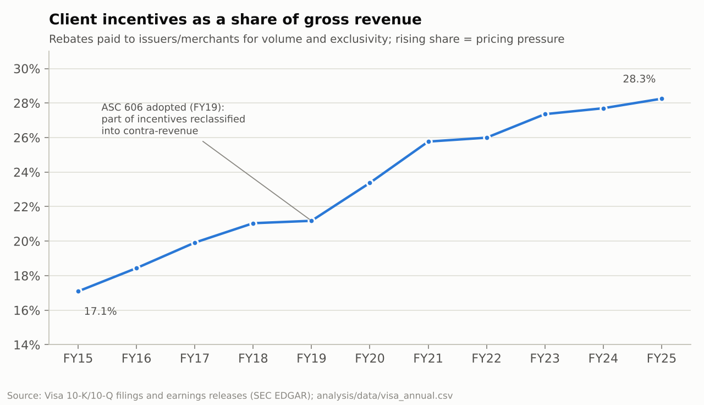

[F] Client incentives rose from **17.1% of gross revenue in FY2015 to 28.3% in FY2025**. In dollars they compounded at 18.6% a year, against 12.8% for gross revenue. Part of the FY2019 step-up is an accounting reclassification (ASC 606).

[J] The trend is the clearest sign that issuers capture a growing share of the value. Visa wins and keeps large issuer portfolios by paying for them, while Mastercard (and now Discover, via Capital One) competes for the same contracts. It is not yet hurting net revenue growth, but it is the metric to watch (Section 12).

### 3.3 Margins, free cash flow and capital intensity

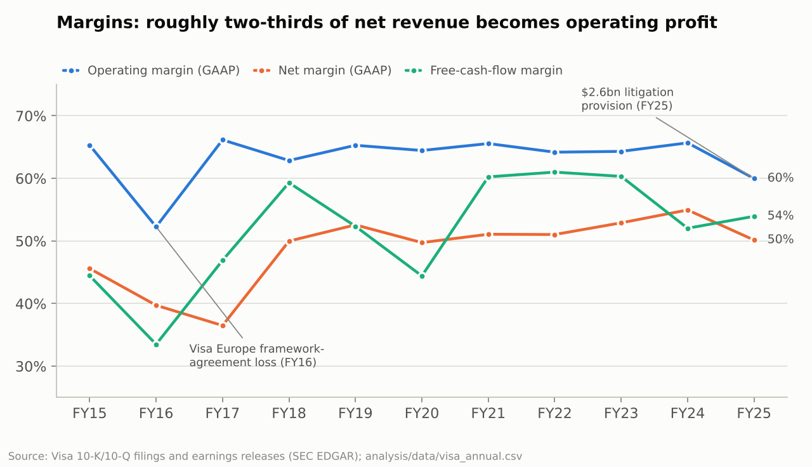

| FY | GAAP op. margin | Net margin | Operating cash flow ($m) | Capex ($m) | FCF ($m) | FCF margin | Capex % rev | SBC % rev |
|---|---:|---:|---:|---:|---:|---:|---:|---:|
| 2015 | 65.3% | 45.6% | 6,584 | 414 | 6,170 | 44.5% | 3.0% | 1.3% |
| 2017 | 66.2% | 36.5% | 9,317 | 707 | 8,610 | 46.9% | 3.9% | 1.3% |
| 2019 | 65.3% | 52.6% | 12,784 | 756 | 12,028 | 52.3% | 3.3% | 1.8% |
| 2021 | 65.6% | 51.1% | 15,227 | 705 | 14,522 | 60.2% | 2.9% | 2.2% |
| 2023 | 64.3% | 52.9% | 20,755 | 1,059 | 19,696 | 60.3% | 3.2% | 2.3% |
| 2024 | 65.7% | 55.0% | 19,950 | 1,257 | 18,693 | 52.0% | 3.5% | 2.4% |
| 2025 | 60.0% | 50.1% | 23,059 | 1,482 | 21,577 | 53.9% | 3.7% | 2.2% |
| TTM to Jun 2026 | – | 50.8% | 22,580 | 1,567 | 21,013 | 47.2% | 3.5% | 2.1% |

*[F] Operating cash flow and capex: [V10K24, VPR25Q4, VER26Q3, VER25Q3]; FY2015–21 from [MT, FB, ZK, SA], which match each other. All years are in `analysis/output/financials_annual.csv`. FY2017 net margin includes a one-off $1.5bn deferred-tax charge [VER17Q4].*

[E] Free cash flow compounded at 13.3% a year over FY2015–25. Capex stays at only 3–4% of revenue. The free-cash-flow margin has drifted down, from about 60% in FY2021–23 to 52–54% in FY2024–25 and 47% over the last 12 months. In the same period operating cash flow fell slightly (9M FY2026 $16.3bn vs $16.8bn) while revenue rose 15% [VER26Q3].

[J] I have not been able to attribute this precisely. It coincides with higher litigation payments (the merchant-case settlement cost $1.05bn in FY2025 [V10K25]), higher cash taxes and incentive pre-payments [V10K24]. **I treat a free-cash-flow margin after stock-based pay of about 51% as normal.** That is the average of FY2023, FY2024, FY2025 and the last 12 months.

### 3.4 Capital returns, share count and stock-based compensation

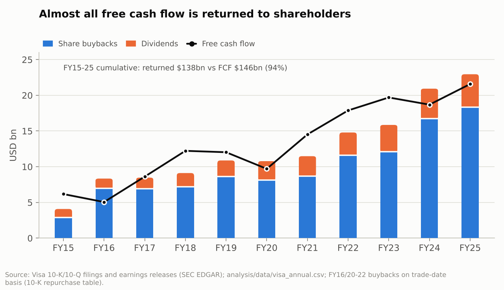

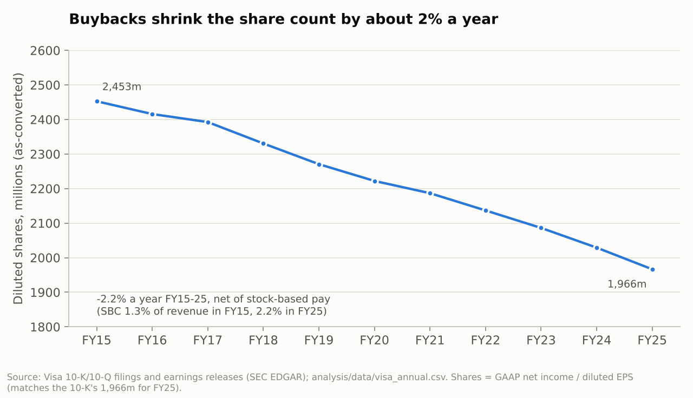

- **Returned to shareholders [F][E].** Over FY2015–25 Visa returned **$138bn** through buybacks ($108bn) and dividends ($30bn). That equals **94% of its $146bn of free cash flow**.
- **Share count [E].** Diluted shares fell from 2,453m to 1,966m, or 2.2% a year. That matches the 1,966m the FY2025 10-K reports [V10K25].
- **Stock-based compensation [E].** It rose from 1.3% to 2.2% of revenue. This is a real cost that free cash flow adds back, so my DCF deducts it.
- **Dividends [F].** The quarterly dividend is $0.67 (2026), a 0.67% yield [VDIV]. Dividends grew 14.7% a year (FY2015–25).
- **Latest year [F].** In the first nine months of FY2026, Visa repurchased $16.5bn of stock. In April 2026 it authorised a new $20bn programme [VER26Q2, VER26Q3].
- **Litigation escrow [F].** Escrow deposits for US "covered" litigation reduce the conversion rate of class B shares, which works like a buyback for class A holders. For example, a $500m deposit in December 2025 cut the B-1 conversion rate to 1.5491 [V8K-ESC].

### 3.5 Return on invested capital

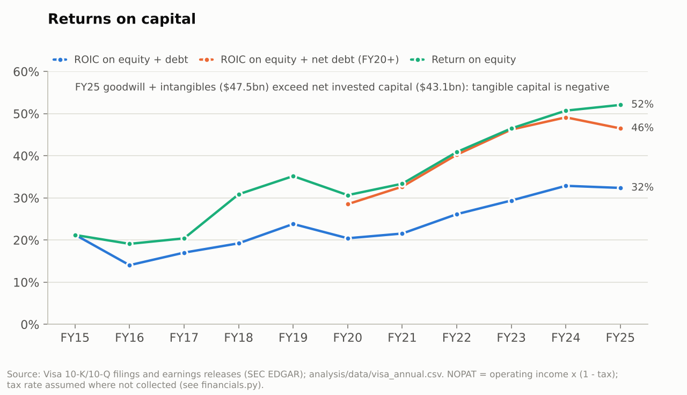

[E] NOPAT is operating income × (1 − tax). Visa's reported tax rate is used for FY2023–25 (18%, 17%, 17% [V10K25]); earlier years use labelled assumptions (30% before the 2018 US tax reform, 19% after).

- **ROIC on equity + debt** rose from 21% (FY2015) to **32% (FY2025)**.
- **Net of cash and investments** it was **46%**, and return on equity was 52%.
- **Tangible capital is negative.** About $47.5bn of FY2025 assets is goodwill ($19.9bn) and acquired intangibles ($27.6bn) [V10K25-R18], mostly from the 2008 restructuring and the Visa Europe deal. Net invested capital is $43.1bn, so tangible capital is below zero.

[J] On the capital the business actually needs, the return is effectively unlimited. Growth needs almost no reinvestment, which is why nearly all FCF can be returned.

### 3.6 Balance sheet, debt and litigation provisions

| 30 Sep | Total equity ($m) | Total debt ($m) | Cash + investments ($m) | Net debt ($m) |
|---|---:|---:|---:|---:|
| 2015 | 29,842 | 0† | n/a | n/a |
| 2020 | 36,210 | 24,070 | 20,272 | 3,798 |
| 2023 | 38,733 | 20,463 | 22,049 | −1,586 |
| 2024 | 39,137 | 20,836 | ≈17,375 | ≈3,461 |
| 2025 | 37,909 | 25,171 | 19,996 | 5,175 |

*[F] [V10K25, V10K23, V10K21, V10K20, MT, SA]. †Visa's first bonds ($16bn) were issued in December 2015 to fund Visa Europe [V10Q16Q1, VEUROPE]. FY2024 cash and investments are approximate.*

[F][E] At 30 September 2025:

- **Debt:** $25.2bn, of which $5.6bn was due within a year, against $20.0bn of cash and investment securities. Net debt was ≈$5.2bn, about 0.2× EBITDA (gross debt ≈1.0× EBITDA).
- **Restricted cash:** a further $3.0bn sat in the US litigation escrow.

[F] Litigation provisions were $927m (FY2023), $462m (FY2024) and **$2,562m (FY2025, 6.4% of revenue)**. FY2025 included $2.21bn for the US merchant (MDL) case. Visa paid $1.05bn on that case in FY2025, leaving a $2.70bn accrual [V10K25]. FY2026 added $707m (Q1) and $311m (Q2) of MDL and other provisions [VER26Q1, VER26Q2].

[J] Litigation is a recurring cost of being Visa. Most of the cost of US "covered" cases is funded via the escrow / class B mechanism, and the uncovered provisions are about $350m a year [V10K25].

---

## 4. Competition and disruption

[J] The big picture: the card rails are not being replaced in the rich-world markets that produce most of Visa's profit. They are being **bypassed at the margin** where governments push alternatives (Brazil, India, eventually the euro area) and **squeezed** where big issuers and regulators gain bargaining power. Visa's answer is to sit on top of the new rails: it tokenises wallets, runs Visa Direct, settles in stablecoins and builds tools for AI-agent payments. That is a credible strategy, but it earns less per transaction than a classic card swipe.

| Challenger | What the evidence shows [F] | How real a threat? [J] | Timeframe | Can Visa participate? |
|---|---|---|---|---|
| **Mastercard** | 2025 net revenue +16% to $32.8bn, GAAP operating margin 57.6% [MA10K25]; Q2 2026 +14% [MAER26Q2] | Rational duopoly; competes on incentives, not price wars | Ongoing | n/a |
| **American Express, Discover / Capital One** | Amex billed business +9% Q2 2026 [AXP]. Capital One moved ~25m debit cards to Discover (Jul 2026) and is issuing some core credit cards on Discover [CAPONE] | **Rising.** Capital One shows a large US issuer can take volume onto its own network | Now – 5 yrs | Partly: Capital One keeps flagship and co-brand cards on Visa for now |
| **PayPal and fintechs** | PayPal Q2 2026 volume +9%, branded checkout only +2%, Venmo +14% [PYPL] | Low to moderate. Most fintech volume still settles on card rails (debit, tokens) | Ongoing | Yes, many are Visa clients |
| **Apple Pay and digital wallets** | EU forced Apple to open iPhone NFC (2024); Vipps launched iPhone tap-to-pay in Norway on the domestic BankAxept scheme [VIPPS] | Low in the US. Moderate in Europe, where wallets can route to domestic or account-to-account schemes | 3–10 yrs | Yes: wallets mostly carry Visa tokens |
| **UPI (India)** | 24.07bn transactions in Sep 2026, +22.6% y/y; merchant fees introduced on some payments from Oct 2026 [UPI] | Very high in India. India is not one of Visa's largest markets: no country besides the US is ≥10% of revenue [V10K25] | Now | Limited |
| **Pix (Brazil)** | Record 318m transactions in one day (4 Sep 2026); ~42% of e-commerce in 2025 vs 41% for credit cards, projected 50% by 2028; recurring and instalment Pix being added [PIX, PIX2] | High in Brazil. Takes the growth that card networks expected from emerging markets | Now – 5 yrs | Limited |
| **FedNow / RTP (US)** | RTP network 142m transactions and FedNow ~5m in Q2 2026, vs Visa's 71.7bn processed in its fiscal Q3 [RTP, VER26Q3]; FedNow has 1,725 member institutions [FEDNOW] | Low at the till; there is no consumer incentive to switch | 10 yrs+ | Partly: Visa Direct already handles real-time push payments |
| **Wero / EPI (Europe)** | ~58m users; live in Belgium, France, Germany, Luxembourg; online in Germany since end-2025; in-store planned 2027; Nordics "planned" [WERO] | Moderate. An explicit political goal of reducing reliance on US schemes | 3–10 yrs | No: designed to bypass |
| **Digital euro** | Parliament mandate 9 Jul 2026 (416–169); trilogue ongoing; ECB targets first issuance by 2029 with holding limits [DIGEUR, DIGEUR2] | Moderate long-term threat to euro-area domestic card volume | 2029+ | No |
| **Stablecoins and crypto rails** | ~$310–320bn outstanding; ~76% of on-chain "volume" is bots; GENIUS Act regime effective ~Jan 2027 [STABLE]. Visa stablecoin settlement run-rate $7bn (Apr 2026, Visa release) and reportedly >$20bn by Sep 2026 [VSTABLE, STABLE-VISA] | Low now. Moderate long-term for cross-border, Visa's richest revenue line | 5–15 yrs | **Yes:** settlement, stablecoin-linked cards, Visa Direct |
| **Buy-now-pay-later** | Klarna and Affirm use Visa Flex Credential (20m credentials); Stripe carries BNPL in agent checkouts [FLEX, AGENTIC] | Low: mostly a complement funded by cards | – | Yes |
| **AI-agent commerce** | Visa Intelligent Commerce, agent-ready tokens; Stripe supports Visa and Mastercard agent tokens [AGENTIC] | Uncertain. An opportunity if agents use network tokens; a threat if they optimise toward cheap account-to-account rails | 2–10 yrs | Yes, actively |

[J] **Threat ranking for a 10–20-year holder:**

1. US routing and steering rules, plus issuer-owned networks (Capital One/Discover), because they hit Visa's largest profit pool.
2. Government account-to-account rails in emerging markets and the EU.
3. Stablecoins in cross-border.
4. Wallets and agents choosing rails.

Mastercard is a competitor, not a threat to the economics.

---

## 5. Regulation and legal risk (status checked October 2026)

| Matter | Current status [F] | What it means for Visa [J] |
|---|---|---|
| **US merchant class action (interchange MDL)** | Amended settlement announced 10 Nov 2025 [V8K-MDL]: credit interchange cut 10bp for 5 years; 1.25% rate on standard consumer credit for 8 years; merchants may decline some premium and commercial cards; surcharging and steering allowed [PD-MDL]. **Preliminary approval 9 Jun 2026**; 978 objectors (10 Sep 2026); fairness hearing **reportedly 16 Nov 2026** (single secondary source) [MCAG]. Not yet in force | The interchange cuts fall on issuers. The risk to Visa is volume and mix: steering and surcharging could shift spend away from premium credit cards. Cash costs are largely funded through the escrow mechanism (FY2025 MDL provision $2.21bn [V10K25]). **Moderate** |
| **DOJ v. Visa (debit monopolisation, S.D.N.Y., filed Sep 2024)** | Motion to dismiss denied (Judge Koeltl); discovery extended into 2027; no trial date set, trial expected ~2028 [PD-DOJ, YF-DOJ] | Targets Visa's debit routing and incentive contracts. A loss could bring conduct remedies on US debit pricing. **Moderate, long-dated** |
| **Credit Card Competition Act (S.3623 / H.R.7035)** | Reintroduced 13 Jan 2026 by Sens. Marshall and Durbin, **endorsed by President Trump**; status "Introduced"; no floor vote found; merchants lobbying to attach it to other bills (Oct 2026) [CCCA, PYMNTS-CCCA] | Would require large issuers to offer a second, non-Visa/Mastercard network on credit cards, which could push down network fees and share. **Low–moderate probability, high impact** |
| **10% credit card interest cap** | Proposed by the President (Jan 2026); Hawley–Sanders bill; no enactment found [RATECAP] | Would shrink credit supply and therefore card spend. **Low probability** |
| **EU** | Commission preliminary inquiry into scheme fees (escalated 2025; no formal charges found) [EC]; inter-regional interchange caps of 0.2%/0.3% extended to Nov 2029 [EC-CAP] | Scheme-fee caps would hit Visa's own fees. **Moderate** |
| **UK** | High Court (15 Jan 2026) upheld the regulator's (PSR's) power to cap UK–EEA online cross-border interchange; scheme- and processing-fee remedies are being developed for 2026/27 [PSR, PSR-PLAN]. Competition Appeal Tribunal: default interchange fees infringe competition law ([2025] CAT 37); 85% pass-on to merchants found ([2026] CAT 11); exemption trial October 2027 [CAT, CAT2] | Damages and fee caps. Visa runs a separate "Europe retrospective responsibility plan" for certain European claims [V10K25]; I could not verify how much of the UK exposure it covers. **Moderate** |
| **Historical precedent** | The 2010–11 Durbin amendment capped US debit interchange. Visa shares rose more than 15% in one day when the Fed's final rule (29 Jun 2011) was looser than feared [DURBIN] | Regulation has repeatedly hurt the valuation multiple more than the long-run earnings [J] |

---

## 6. Macroeconomic analysis

### 6.1 How the economy flows through to revenue
- **Nominal spending is the input.** Fees are mostly charged on payments volume and transactions, so revenue tracks *nominal* consumer spending, plus the steady shift from cash to card. [E] Visa's real revenue growth (deflated by US CPI) was positive in every fiscal year from 2016 to 2025 except FY2020. In FY2022, with inflation at 8.2%, net revenue grew 21.6%.
- **Inflation and real growth.** Inflation raises nominal revenue directly. Real growth and employment drive transaction counts and volume. A recession hits volume growth but rarely makes it negative, except in cross-border.
- **Weaker phases.** US payments volume fell 2% (nominal) in Q4 FY2009 [V10K09]. In FY2020 it still grew +2% in constant dollars, while cross-border fell 22% [VER20Q4].

| FY | US CPI (Sep y/y) | Visa net revenue growth | Real growth |
|---|---:|---:|---:|
| 2020 | 1.4% | −4.9% | −6.2% |
| 2021 | 5.4% | 10.3% | 4.7% |
| 2022 | 8.2% | 21.6% | 12.4% |
| 2023 | 3.7% | 11.4% | 7.4% |
| 2024 | 2.4% | 10.0% | 7.4% |
| 2025 | 3.0% | 11.3% | 8.1% |

*[F] BLS CPI-U via [CPI]; Visa growth from the financial table; computed in `macro_fx.py`.*

### 6.2 Interest rates
- **Direct exposure is small [F].** Visa earns interest on about $20bn of cash and investments and pays interest on $25bn of bonds, and it has no lending book [V10K25].
- **Rates matter through two other channels [J]:**
  - **The valuation multiple.** The 10-year Treasury at **5.08%** [UST-OCT16] makes a 2.75% free-cash-flow yield expensive by historical standards (chart 09). The 2022 drawdown (−24.5%) happened while revenue grew 21.6% and was entirely a de-rating.
  - **Consumer credit.** High rates and a weakening job market slow credit-card spending and issuers' appetite to grow.

### 6.3 The dollar and FX volatility
- **Exposure [F].** About 61% of net revenue is earned outside the US [V10K25]. A stronger dollar lowers reported revenue; the FX headwind was about 3pp in FY2009 [V10K09].
- **Volatility helps [F].** Currency volatility *raises* international transaction revenue, because Visa earns currency-conversion fees. Higher volatility helped that line in FY2025 [V10K25].
- **Net effect [J].** Revenue is partly hedged against currency shocks. A sharp dollar rally hurts reported growth for a year or two.

### 6.4 Cross-border travel and e-commerce
[F] UN Tourism reports international arrivals of only **+0.4% in H1 2026**: Q2 −1%, Middle East −22%. It cut its 2026 forecast to +1–2% because of the Middle East war, oil prices and costs [UNTOUR]. Even so, Visa's cross-border volume grew 11–12% (constant dollars) in each FY2026 quarter. That was helped by **cross-border e-commerce, +16% in Q3**, which management said was moderating in July [VER26Q3, VCALL26Q3]. [J] Cross-border is Visa's most profitable and most cyclical line, and the current travel backdrop is soft.

### 6.5 Cash-to-digital in emerging markets
[F] Visa estimates global consumer spending (excluding Russia and China) at about $40tn, with more than $20tn addressable. Roughly half of that addressable pool is still cash and cheque. It puts the "new flows" opportunity (B2B, payouts, person-to-person) at about $200tn [VCALL24Q2]. [J] That runway is real, but in the largest emerging markets (Brazil, India) instant-payment systems are capturing much of it instead of cards (Section 4). The tailwind persists, though it is smaller than a decade ago.

### 6.6 The current macro picture (October 2026)
- **US labour market and inflation [F].** September payrolls rose only **+29k** and unemployment reached **4.2%**, the highest since 2021 [JOBS]. CPI was **3.7%** (core 2.6%), driven by energy during the **US–Iran war** that began in late February 2026 [CPI-SEP26, OIL2]. Brent was about $96 in early September as Strait of Hormuz shipping stayed disrupted [OIL].
- **Monetary policy and rates [F].** The Fed **raised** its policy rate 25bp to 3.75–4.00% on 16 Sep 2026 [FOMC]. The 10-year Treasury is at 5.08% and the 30-year at 5.43% [UST-OCT16].
- **Global growth [F].** The IMF (October 2026) sees world growth of 3.1% in 2026 and 3.4% in 2027. US growth is 2.3% in both years and the euro area 1.1%/1.2%, with oil assumed around $96 [IMF].
- **Trade [F].** The US Supreme Court struck down the IEEPA tariffs on 20 Feb 2026. The effective US tariff rate was about 7.1% in August 2026 [PWBM, BROOKINGS].
- **My read [J].** This is a late-cycle, stagflation-tinged backdrop with recession risk clearly above normal. That matters for the next 1–2 years of cross-border and for the multiple, much less for a 10–20-year holder.
- **Country risk: the Russia precedent [F][J].** Visa switched off Russia in March 2022, losing about **4% of net revenue** (FY2021 base) almost overnight [V10Q22Q2]. FY2022 revenue still rose 21.6%. Geopolitics can remove a market quickly, but a single country is rarely decisive for a network this diversified (the US is ~39%, no other country ≥10%).

### 6.7 How Visa held up in past downturns

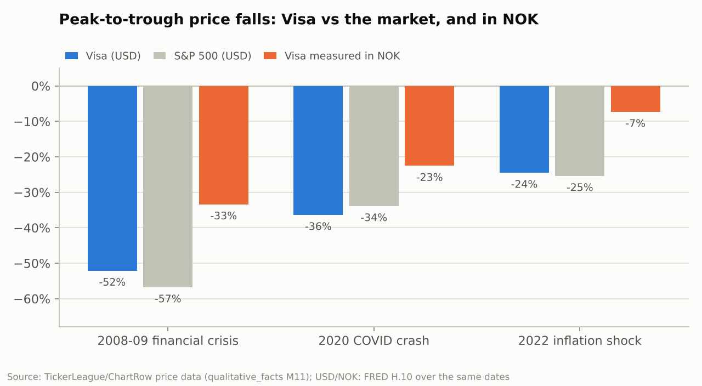

| Episode | Visa share price, peak to trough | S&P 500 | Visa revenue in the downturn year | Visa in NOK |
|---|---:|---:|---|---:|
| 2008–09 financial crisis (May 2008 → Jan 2009) | −52.1% | −56.8% | FY2009 operating revenue **+10%** ($6.91bn vs $6.26bn) [V10K09] | −33% |
| 2020 COVID crash (19 Feb → 23 Mar 2020) | −36.4% | −33.9% | FY2020 net revenue **−4.9%** (cross-border −22%) [VER20Q4] | −23% |
| 2022 inflation shock (Feb → Oct 2022) | −24.5% | −25.4% | FY2022 net revenue **+21.6%** | −7% |

*[F] Price drawdowns from [TICKERLEAGUE]; NOK column [E] combines them with USD/NOK over the same dates [H10].*

[J] The business is far more defensive than the stock. Revenue grew in 2009 and dipped only 5% in 2020, yet the shares fell about as much as the market each time. You must expect −35% to −50% drawdowns in USD even with a "safe" compounder. For a NOK investor they have historically been much milder, because the krone weakens in crises (Section 11).

---

## 7. Valuation

### 7.1 Multiples vs Visa's own history, Mastercard and the S&P 500

| Metric (16 Oct 2026) | Visa | Mastercard | S&P 500 |
|---|---:|---:|---:|
| P/E, trailing GAAP | 34.3× | 34.0× | 28.7× (Multpl, as-reported, Jul 2026) |
| P/E, trailing adjusted / non-GAAP | 31.5× | 32.9× | 25.7× (FactSet, operating) |
| P/E, forward | 30.6× (FY2026E), **26.9× (FY2027E)** | 31.5× (2026E) | **19.0×** (next 12 months) |
| EV/EBIT, FY2025 GAAP / non-GAAP | 32.0× / 28.3× | – | – |
| EV/EBIT, FY2026E (consensus revenue × FY2025 non-GAAP margin) | 24.8× | – | – |
| FCF yield (TTM) / after SBC | 2.75% / 2.63% | – | – |
| Dividend yield | 0.67% | – | – |

*[E] `valuation.py`. Inputs [F]: Visa [MORN, ZACKS]; Mastercard [GOOGMA, MSCREEN, MA10K25, MAER26Q1, MAER26Q2]; S&P 500 [FACTSET, FACTSET2, MULTPL]. Mastercard's trailing EPS reconciles to Google Finance's $18.18.*

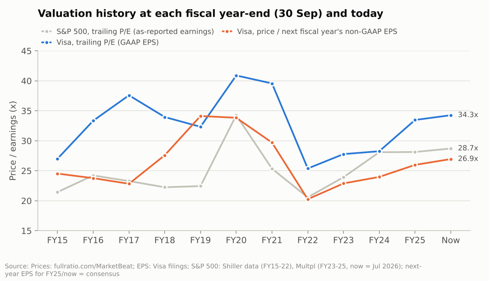

| At each 30 Sep, FY2015–25 | Median | Range | Now | Percentile of now vs history |
|---|---:|---:|---:|---:|
| P/E on GAAP EPS | 33.3× | 25.4×–40.9× | 34.3× | 73rd |
| P/E on non-GAAP EPS | 29.8× | 23.7×–39.7× | 31.5× | 64th |
| Price ÷ *next* year's non-GAAP EPS | 24.5× | 20.3×–34.1× | 26.9× | 64th |
| FCF yield | 3.35% | 2.2%–4.7% | 2.75% | 18th (i.e. more expensive than 82% of history) |
| FCF yield minus 10-year Treasury | +1.2pp | −0.9pp to +1.6pp | **−2.3pp** | **lowest in the series** |
| P/E premium vs S&P 500 (trailing) | +26% | +1% to +61% | +19% | 36th |

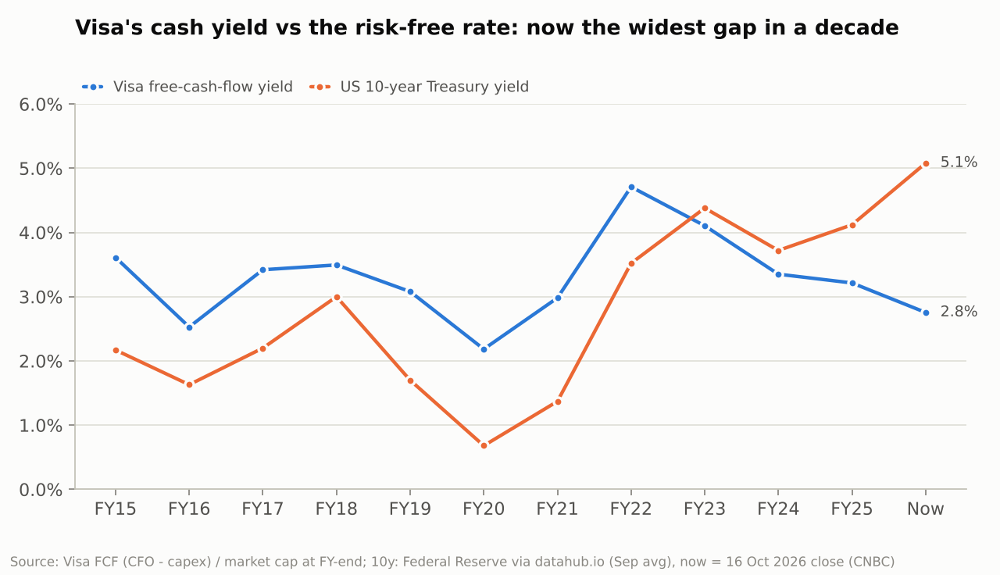

**Reading the tables:**

- **[E] Against its own history:** Visa is somewhat expensive (64th–73rd percentile on P/E), not extreme.
- **[E] Against Mastercard:** slightly cheaper on adjusted and forward P/E, but Mastercard is growing faster (2025 revenue +16% vs +11%).
- **[J] Against the bond market:** the striking change. Until 2022 Visa's FCF yield was 0.5–1.6pp *above* the 10-year Treasury. Today it is 2.3pp *below*. Buyers are paying growth-stock prices in a 5%-rate world, which relies on growth staying near 10% for a long time.

### 7.2 Discounted cash-flow (DCF) model

| Assumption | Value | Justification |
|---|---|---|
| Base revenue | FY2026E $45.7bn | Consensus after Q3 [ZACKS]; 9M actual +15.3% [VER26Q3] |
| Revenue growth FY2027–31 | **10%** a year | Consensus FY2027 +10.3%, FY2028 +10.8% [ZACKS, SWS]; history 10.2% (FY2017–25) |
| Fade FY2032–36 | Linear to 4% | Maturity, regulation, account-to-account competition |
| Terminal growth | **4%** nominal | ≈2% inflation + 2% real, below long-run nominal world GDP |
| FCF after stock-based pay, % of revenue | **51.1%** | Mean of FY2023 (58.0%), FY2024 (49.7%), FY2025 (51.7%) and TTM (45.2%); held flat |
| Discount rate | **8.5%** | CAPM gives 8.23%: 5.08% 10-year Treasury [UST-OCT16] + beta 0.75 [BETA] × 4.20% equity risk premium [DAMODARAN], rounded up for single-company and regulatory uncertainty |
| Net debt / shares | $5.2bn / 1,895m | 30 Sep 2025 balance sheet; Q3 FY2026 diluted (as-converted) shares |

**[E] Result:** **$419 per share, 4% above today's $402.61.** The present value of FY2027–36 cash flows is $253bn and the terminal value $546bn, so **68% of the value lies beyond 2036**.

[E] A single-stage check: today's price is consistent with **5.6% perpetual growth** in next year's FCF at an 8.5% discount rate.

### 7.3 Reverse DCF: what is priced in?

| Discount rate | FCF margin 45% | **FCF margin 51.1%** | FCF margin 54% |
|---|---:|---:|---:|
| 8.0% | 9.5% (7.8%) | 7.3% (6.3%) | 6.4% (5.7%) |
| **8.5%** | 11.5% (9.2%) | **9.3% (7.7%)** | 8.4% (7.1%) |
| 9.0% | 13.5% (10.6%) | 11.2% (9.0%) | 10.2% (8.3%) |
| 9.5% | 15.3% (11.8%) | 13.0% (10.2%) | 12.0% (9.5%) |

*Revenue growth for FY2027–31 needed to justify $402.61; in brackets, the implied 10-year revenue CAGR. [E] `reverse_dcf.csv`.*

[J] At my base inputs, the market prices in **about 9% revenue growth for five years, fading to 4%**. That is roughly the 10% Visa delivered over FY2017–25, so it is achievable. But it *is* the track record: the price gives no credit for a slowdown, and if investors demand 9.5% instead of 8.5%, the implied growth jumps to 13%.

### 7.4 Sensitivity: value per share (USD)

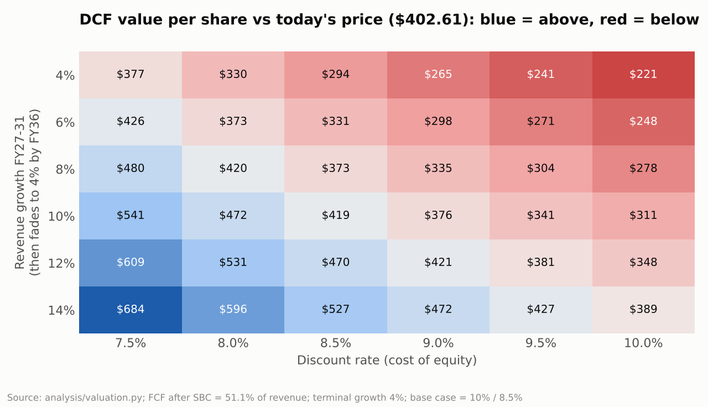

| Revenue growth FY27–31 \ Discount rate | 7.5% | 8.0% | 8.5% | 9.0% | 9.5% | 10.0% |
|---|---:|---:|---:|---:|---:|---:|
| 4% | 377 | 330 | 294 | 265 | 241 | 221 |
| 6% | 426 | 373 | 331 | 298 | 271 | 248 |
| 8% | 480 | 420 | 373 | 335 | 304 | 278 |
| **10%** | 541 | 472 | **419** | 376 | 341 | 311 |
| 12% | 609 | 531 | 470 | 421 | 381 | 348 |
| 14% | 684 | 596 | 527 | 472 | 427 | 389 |

Also in `analysis/output/` [E]:

- **Terminal growth 3% → 5%** at 8.5%: $357 → $516.
- **FCF margin 45% → 57%** at 8.5%: $368 → $467.

[J] The model says "about fair value". The uncertainty is mostly in the discount rate and the terminal value, and nothing in it offers a margin of safety.

---

## 8. Scenarios (5 and 10 years from 16 Oct 2026)

**Method [E] (`scenarios.py`):**

- Start from FY2027 consensus non-GAAP EPS of $14.94 [ZACKS].
- Grow EPS at the scenario rate.
- Exit at a forward P/E.
- Collect dividends at today's 21% payout ratio.
- The return is the IRR in USD. The probabilities are my judgment.

| Scenario (probability) | Story [J] | EPS growth, yrs 1–5 / 6–10 | Exit P/E, 5 yrs / 10 yrs | Price in 2031 | **5-yr return** | Price in 2036 | **10-yr return** |
|---|---|---|---|---:|---:|---:|---:|
| **Bear (25%)** | CCCA or a hard DOJ remedy; faster account-to-account and wallet bypass; more Capital One-style defections; rising incentives; a 2027 recession. Loses its premium and trades near today's S&P 500 multiple (19×) | 5% / 4% | 18× / 16× | $343 | **−2.2%** | $371 | **+0.2%** |
| **Base (50%)** | Revenue growth fades from ~10% to ~8%, flat margins, ~2%/yr buybacks; regulation is friction, not damage; the multiple drifts to its 10-year median as growth matures and long rates stay near 5% | 11% / 9% | 24× / 22× | $604 | **+9.3%** | $852 | **+8.7%** |
| **Bull (25%)** | Value-added services, Visa Direct/B2B, AI-agent and stablecoin flows accelerate; China licence; benign regulation; operating leverage | 14% / 12% | 28× / 26× | $805 | **+15.6%** | $1,318 | **+13.4%** |
| **Probability-weighted** | | | | $589 | **+8.6%** | $848 | **+8.4%** |

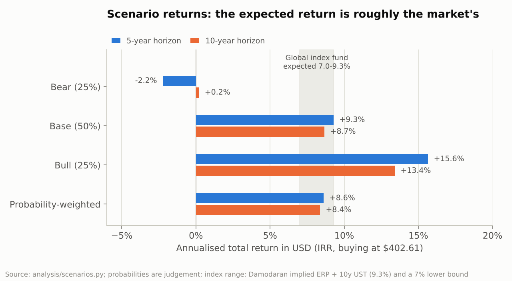

**5-year return (%/yr) as a function of EPS growth and exit P/E [E]:**

| EPS CAGR FY27–32 \ exit P/E | 18× | 20× | 22× | 24× | 26× | 28× | 30× |
|---|---:|---:|---:|---:|---:|---:|---:|
| 7% | −0.4 | 1.7 | 3.6 | 5.4 | 7.0 | 8.6 | 10.1 |
| 9% | 1.5 | 3.6 | 5.5 | 7.3 | 9.0 | 10.6 | 12.1 |
| **11%** | 3.3 | 5.4 | 7.4 | **9.3** | 11.0 | 12.6 | 14.2 |
| 13% | 5.2 | 7.3 | 9.4 | 11.2 | 13.0 | 14.6 | 16.2 |
| 15% | 7.0 | 9.2 | 11.3 | 13.2 | 15.0 | 16.6 | 18.2 |

[J] A double-digit return from here needs one of three combinations:

- **11% EPS growth with a 26× exit multiple**
- **13% with 24×**
- **15% with 22×**

All are possible. None is the median outcome, which is closer to growth fading toward 9–11% and a multiple drifting down toward 22–24×.

**Price at which the probability-weighted expected return reaches a target [E] (`buy_below_prices.csv`):**

| Target expected return | 5-year horizon | 10-year horizon |
|---|---:|---:|
| 9% | $396 | $380 |
| **10%** | $378 | **$346** (≈23.2× FY2027E) |
| 11% | $361 | $316 |
| 12% | $345 | $289 |

---

## 9. Red team: the strongest case for *not* buying Visa

| # | Argument | Does it hold up? [J] |
|---|---|---|
| 1 | **You're paying a growth multiple in a 5% world.** FCF yield 2.75% vs a 5.08% risk-free rate; in 2022 the stock fell 24.5% while revenue grew 21.6% | **Holds.** No margin of safety, and the multiple is the most likely source of a poor 5-year return |
| 2 | **Regulators are closing in from every side at once:** the MDL settlement (steering, surcharging, honor-all-cards), a presidentially backed CCCA, the DOJ debit case, UK caps and damages, the EU fee probe, the digital euro | **Partly holds.** Each has a precedent of being survivable (Durbin, the EU interchange caps), and most interchange rules hit issuers, not Visa. But steering and routing rules attack the network's own pricing |
| 3 | **The largest issuers are learning to route around Visa.** Capital One is moving cards to Discover [CAPONE]; JPMorgan-sized issuers have leverage on incentives, which already take 28% of gross revenue | **Holds, and is under-appreciated.** It is the most direct threat to US volume and is visible in the rising incentive ratio |
| 4 | **The emerging-market growth runway is being captured by state rails** (Pix, UPI), and Europe is building its own (Wero, the digital euro) | **Holds for the long term.** It shrinks the "cash-to-digital" story, but the effect is slow and mostly felt in growth, not today's revenue |
| 5 | **Stablecoins will disintermediate cross-border**, the richest line (international transaction revenue $14.2bn) | **Weak for now:** volumes are mostly trading and bots, and Visa itself settles in stablecoins. It is a credible 10–20-year question, not a 5-year one |
| 6 | **Macro is turning:** +29k payrolls, unemployment 4.2%, CPI 3.7%, a Fed hike, war-driven oil, flat tourism. Cross-border fell 22% in 2020 | **Holds near-term only.** Revenue resilience is excellent (FY2009 +10%), but the stock would still fall 30%+ in a recession |
| 7 | **Litigation never ends:** $2.6bn of provisions in FY2025, UK damages pending | **Mostly does not hold.** US covered cases are largely funded through escrow; uncovered provisions are ~$350m/yr, about 1% of revenue |
| 8 | **The stock just jumped 12% in two weeks**, ahead of results | **Holds as a timing point,** not as a thesis point |
| 9 | **Base rates:** most single stocks and most stock-pickers trail the index; Visa is already in your index fund | **Holds.** Unless Visa offers clearly higher expected returns, the index wins on risk-adjusted terms (Section 10) |
| 10 | **Norway-specific friction:** not allowed in an ASK, 15% US withholding tax, currency risk | **Weak.** Taxes are close to neutral for a buy-and-hold investor (Section 11), and the index fund carries similar USD exposure |

**Verdict [J].** Arguments 1, 3, 4 and 9 survive scrutiny. They do not say Visa is a bad business. They say that **at $402 you are paying full price for a great business whose growth is more likely to slow than speed up.** This shapes the recommendation more than anything else in the report.

---

## 10. Visa vs a global index fund

- **Expected return [E].** Visa's probability-weighted expected return is **8.4–8.6%/yr in USD**. A global equity index has two reference points:
  - **Market-implied:** about 9.3% (5.08% 10-year Treasury + 4.20% implied equity risk premium [DAMODARAN]).
  - **Lower bound:** about 7%. That is my reading of J.P. Morgan's 2026 estimate of 6.4% for a 60/40 portfolio [JPM], which implies about 7.3% for the equity part if bonds earn about 5%.

  Visa's expected return sits **inside** that range: roughly −0.9pp to +1.6pp versus the index. This is consistent with its CAPM cost of equity (8.2%) and suggests the market prices it fairly [J].
- **Risk.** A single stock carries company-specific risks that a global index of thousands of stocks diversifies away. For Visa these are regulation, issuer defection and disruption. Visa's beta is low (0.75 [BETA]), but its drawdowns have still matched the market's (−36% in 2020, −52% in 2008–09).
- **Base rates [F].** Over 1926–2016, just 4.3% of US stocks (1,092 of about 26,000) created all the wealth above Treasury bills [BESSEMBINDER]. Over the 20 years to end-2025, about 93% of US large-cap active funds trailed the S&P 500 (90% over 15 years, 86% over 10) [SPIVA, NGPF]. Visa has been one of the rare long-term winners: about 18%/yr total return in USD since September 2015 versus about 13% for the S&P 500 on price alone [E]. Past winners being future winners is the exception, though.
- **Overlap.** The index already owns Visa, at about 0.57% of MSCI ACWI [MSCI]. A NOK 40k Visa position in a NOK 500k portfolio would raise your Visa exposure from about 0.6% to 8.5%.

**[J] Conclusion.** At today's price, Visa's expected return does **not** compensate for the concentration risk. The honest base rate favours the index, unless you can buy Visa at a price that offers a clear premium. I would want 1–3pp a year above the index, which points to about $345 or below.

---

## 11. Considerations for a Norwegian investor

### 11.1 USD/NOK exposure

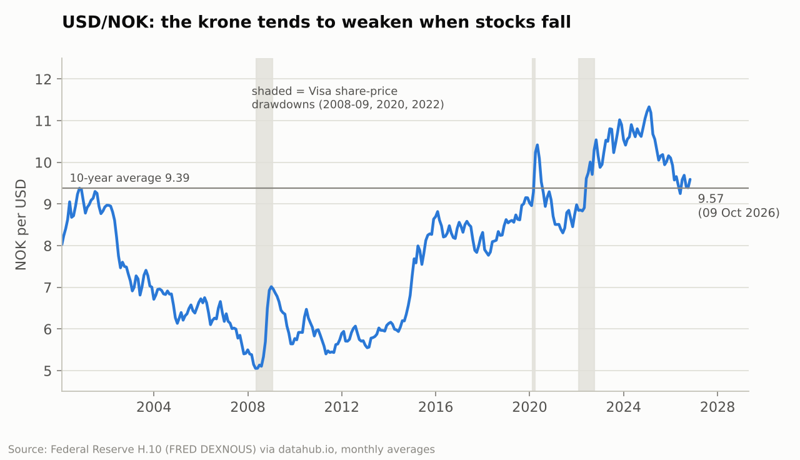

[F][E] USD/NOK was **9.57** on 9 Oct 2026, the latest Federal Reserve H.10 print [H10]. That is above the 10-year average (9.39) and well above the 20-year average (7.86). The range since 2000 runs from 4.95 (Apr 2008) to 11.68 (Mar 2020), and annual volatility is about 8.8%.

**[E] Effect on returns:**

| 5-year probability-weighted return | NOK strengthens to 8.50 | Flat at 9.57 | NOK weakens to 10.50 |
|---|---:|---:|---:|
| In NOK, %/yr | 6.1% | 8.6% | 10.7% |

- **[E] Downside cushion.** The krone tends to weaken when stocks fall. The monthly correlation between the S&P 500 and USD/NOK was −0.35 over 2000–2026, and USD/NOK rose 1.35% on average in months when the S&P fell more than 3%. Over the three drawdowns above, USD/NOK rose 39%, 22% and 23%. Visa's −52% in 2008–09 was about −33% in NOK.
- **[E] Track record.** Since 30 Sep 2015 Visa has returned about 18.0%/yr in USD and 19.2%/yr in NOK, helped by a weaker krone.

[J] USD exposure is a *diversifier* for a Norwegian investor in a crisis. The long-run risk is a recovery of the krone; a return to the 20-year average would cost about 2pp a year over 10 years. Note that your global index fund carries similar (if smaller) USD exposure, since US stocks are about two-thirds of global indices, so currency is not a reason to prefer one over the other.

### 11.2 Can Visa be held in an aksjesparekonto (ASK)?
**No [F].** An ASK can hold only listed shares and equity certificates of companies **resident in the EEA**, plus equity funds with more than 80% in equities. US companies such as Visa are not eligible [ASK, NORDNET-ASK]. AksjeNorge reported proposals in June 2026 to widen the scheme to Euronext Growth shares; this does not affect US stocks [ASK]. A global index fund **can** be held in an ASK.

### 11.3 Tax on gains and dividends, and US withholding (W-8BEN)
- **Rate [F].** Share income for individuals (dividends and gains) is multiplied by 1.72 and taxed at 22%, an **effective 37.84% in both 2025 and 2026** [TAX, TAX2]. Gains and losses are calculated in NOK, so currency moves are part of the taxable gain.
- **Shielding deduction [F].** The *skjermingsfradrag* (cost basis × an annually set rate) is deducted against dividends first, and any unused amount carries forward to the gain. Secondary sources disagree on the 2025 rate (2.5% vs 3.6%), so check Skatteetaten. I use 3% for illustration [E].
- **US withholding [F].** The US withholds **15%** on dividends under the US–Norway tax treaty if you have filed a **W-8BEN** with your broker (otherwise 30%). Norway credits the US tax up to the Norwegian tax on that dividend [TREATY].
- **Nuance [J].** Visa's 0.67% yield is small relative to the shielding deduction, so in early years Norwegian tax on the dividend may be zero. The 15% US tax then cannot be credited that year. This costs about NOK 40 a year on NOK 40k, roughly NOK 600 over 10 years [E]. Check it with Skatteetaten or your broker.
- **Wealth tax [F].** Listed shares and equity funds (including ASK holdings) are both valued at 80% for wealth tax, at rates of 1.0%/1.1% above the thresholds. This is neutral between Visa and an index fund [WEALTH, WEALTH2].

**[E] After-tax illustration, NOK 40,000 for 10 years with USD/NOK flat** (`norway_tax.py`, before brokerage and FX fees):

| Case | Pre-tax return | After-tax wealth | After-tax %/yr |
|---|---:|---:|---:|
| Visa, base case (ordinary account) | 8.7% | NOK 75,300 | 6.5% |
| Visa, probability-weighted | 8.4% | NOK 73,800 | 6.3% |
| Global index fund in ASK at 7% (0.2% fee) | 7.0% | NOK 67,700 | 5.4% |
| Global index fund in ASK at 9.3% | 9.3% | NOK 79,000 | 7.0% |

[J] Tax treatment barely separates the two for a buy-and-hold investor. The ASK's real advantage is flexibility: you can switch or rebalance without triggering tax. Brokerage commissions and currency-exchange fees on US shares are not modelled; check your broker's price list, as they matter more on small, repeated trades.

### 11.4 Sensible position sizing
[J] A common rule of thumb is to keep any single stock at **5% or less** of your liquid investments, and at most about 10% for a high-conviction, high-quality name.

| Your total portfolio (NOK) | NOK 30k in Visa | NOK 40k | NOK 50k | Visa already held through an index fund |
|---|---:|---:|---:|---:|
| 200,000 | 15% | 20% | 25% | ≈ NOK 1,100 |
| 500,000 | 6% | 8% | 10% | ≈ NOK 2,900 |
| 1,000,000 | 3% | 4% | 5% | ≈ NOK 5,700 |
| 2,000,000 | 1.5% | 2% | 2.5% | ≈ NOK 11,400 |

*[E] `position_sizing.csv`.*

[J] NOK 30–50k is sensible if your total portfolio is roughly NOK 600k–1m or more. Below that, it would be a concentrated bet.

---

## 12. Recommendation and monitoring

### Final recommendation: **HOLD/WAIT** (confidence: medium)

[J] Visa is one of the highest-quality businesses you can buy. Its revenue held up in recessions, it needs no capital to grow, and it returns about 94% of its free cash flow. But at **$402.61** its expected return of about **8.5%/yr** is no better than a global index fund that already owns it. The risks to that return (multiple compression in a 5%-rate world, US routing and steering rules, issuer-owned networks, state payment rails) are concentrated rather than diversified.

**What I would do in your position:**

1. Don't buy at today's price, right after a 12% two-week rally and ten days before full-year results.
2. Keep the money in the global index fund (in your ASK) in the meantime.
3. Revisit after the **27 October** results and the **16 November** court hearing on the merchant settlement.

**Confidence is medium, not high**, for four reasons:

- The business-quality conclusion is high-confidence, but the valuation conclusion depends on a discount rate (8–9%) and long-run growth that nobody can know.
- At an 8.0% discount rate, the DCF says Visa is worth $472, which would be a BUY.
- The data was compiled through a search tool rather than downloaded directly, although it passes every consistency check.
- FY2026 results arrive within days.

### What would change the recommendation

| Trigger | New view |
|---|---|
| Price at or below **~$345** (≈23× FY2027E EPS, FCF yield ≈3.2%) with the business intact. Visa traded at $341 at end-Sep 2025 [TIPRANKS] | **BUY**: ≈10%/yr expected 10-year return, about 1–3pp above the index. Consider staging the purchase in 2–3 tranches |
| Price $345–$380 | Small starter position acceptable (≤1/3 of the planned amount) |
| FY2027 guidance (27 Oct) of high-teens EPS growth, plus a final MDL settlement without merchant behaviour changing | Raise the base case; the buy-below level rises toward $370–380 |
| The CCCA is enacted, a DOJ remedy restricts debit contracts, or another top-5 US issuer moves volume off Visa | Move toward **DON'T BUY** at any price near today's |

### 3–5 signals that the thesis is breaking

1. **Pricing power:** client incentives above **30% of gross revenue** while revenue growth slows. In FY2025 the ratio was 28.3%, rising about 1pp a year.
2. **US volume share:** Visa's US payments volume growth falling clearly below US nominal consumer-spending growth for several quarters, or more issuers following Capital One onto proprietary networks.
3. **Regulation:** a Senate cloture vote on the CCCA; DOJ remedies; merchants actually surcharging or declining premium cards after the MDL settlement takes effect.
4. **Account-to-account substitution in Visa's growth markets:** Pix above 50% of Brazilian e-commerce, Wero's in-store launch (planned 2027) gaining real share, or the digital euro passing trilogue with generous holding limits.
5. **Growth engines stalling:** constant-dollar net revenue growth below ~8% outside a recession, or value-added services growth (24% in FY2025) dropping into single digits.

---

## Appendix A: methodology, limitations and how to rerun

- **Rerun everything:** `python analysis/run_all.py`, or add `--skip-download` to reuse the cached raw data. It needs Python 3 with pandas, numpy and matplotlib.
- **Data files:** `analysis/data/visa_annual.csv` (305 Visa figures, each with a `source_id`), `visa_quarterly.csv`, `market_data.csv`, `visa_fy_end_prices.csv`, `mastercard_annual.csv`, `qualitative_facts.csv` (55 dated facts behind the narrative), `sources.csv`, and `raw/` (downloaded datasets).
- **Scripts:**
  - `financials.py`: 10-year table, consistency checks, trailing 12 months.
  - `valuation.py`: multiples, DCF, reverse DCF, sensitivities.
  - `scenarios.py`: scenarios, NOK translation, index comparison, buy-below prices.
  - `macro_fx.py`: currency, downturns, CPI.
  - `norway_tax.py`: after-tax illustration.
  - `charts.py`: all charts.
  - `verify_with_sec_xbrl.py`: optional cross-check against SEC XBRL data.
- **Known limitations:**
  - **Data collection:** figures were collected with a web-search tool (direct SEC/FRED downloads were blocked), then checked by internal reconciliation.
  - **Lower-confidence items:** FY2020 processed transactions (secondary source); FY2022 cross-border growth (nominal 40% vs constant-dollar 49% ambiguity); FY2024 cash and investments (approximate); tax rates for NOPAT before FY2023 (assumed).
  - **Mixed buyback bases:** some buyback years are on a trade-date rather than a cash basis.
  - **S&P 500 P/E sources:** different providers (Shiller, Multpl, FactSet) are used for different years, and their definitions differ.
- **Charts:** colours use a palette validated for colour-vision deficiency; every chart has a table twin in `analysis/output/`.

---

## Sources

All accessed 17 October 2026 (via web search where the host was not directly reachable). **Type:** P = primary (company filing or official publication), S = secondary.

**Visa filings and releases (P)**
- [V10K25] Visa Inc., Form 10-K, FY ended 30 Sep 2025 (filed 6 Nov 2025): https://www.sec.gov/Archives/edgar/data/1403161/000140316125000089/v-20250930.htm ; XBRL R18 (goodwill/intangibles): https://www.sec.gov/Archives/edgar/data/1403161/000140316125000089/R18.htm ; R22 (settlement guarantee): https://www.sec.gov/Archives/edgar/data/1403161/000140316125000089/R22.htm
- [V10K24] Form 10-K FY2024: https://www.sec.gov/Archives/edgar/data/1403161/000140316124000058/v-20240930.htm
- [V10K23] Form 10-K FY2023: https://www.sec.gov/Archives/edgar/data/1403161/000140316123000099/v-20230930.htm
- [V10K22] Form 10-K FY2022: https://www.sec.gov/Archives/edgar/data/1403161/000140316122000081/v-20220930.htm
- [V10K21] Form 10-K FY2021: https://www.sec.gov/Archives/edgar/data/1403161/000140316121000060/v-20210930.htm
- [V10K20] Form 10-K FY2020: https://www.sec.gov/Archives/edgar/data/1403161/000140316120000070/v-20200930.htm
- [V10K19] Form 10-K FY2019: https://www.sec.gov/Archives/edgar/data/1403161/000140316119000050/v093019form10k.htm
- [V10K18] Form 10-K FY2018: https://www.sec.gov/Archives/edgar/data/0001403161/000140316118000055/v093018.htm
- [V10K17] Form 10-K FY2017: https://www.sec.gov/Archives/edgar/data/1403161/000140316117000044/v093017.htm
- [V10K16] Form 10-K FY2016: https://www.sec.gov/Archives/edgar/data/0001403161/000140316116000058/v093016.htm
- [V10K15] Form 10-K FY2015: https://www.sec.gov/Archives/edgar/data/1403161/000140316115000013/v093015.htm
- [V10K09] Form 10-K FY2009: https://www.sec.gov/Archives/edgar/data/0001403161/000119312509239249/d10k.htm
- [V10Q26Q3] Form 10-Q, quarter to 30 Jun 2026 (filed 28 Jul 2026): https://www.sec.gov/Archives/edgar/data/0001403161/000140316126000104/v-20260630.htm
- [V10Q26Q2] Form 10-Q, quarter to 31 Mar 2026: https://www.sec.gov/Archives/edgar/data/0001403161/000140316126000079/v-20260331.htm
- [V10Q22Q2] Form 10-Q, quarter to 31 Mar 2022 (Russia): https://www.sec.gov/Archives/edgar/data/1403161/000140316122000027/v-20220331.htm
- [V10Q16Q1] Form 10-Q, quarter to 31 Dec 2015 ($16bn senior notes): https://www.sec.gov/Archives/edgar/data/0001403161/000140316116000015/v123115form10q.htm
- [VER26Q3] Q3 FY2026 earnings release (28 Jul 2026): https://www.sec.gov/Archives/edgar/data/0001403161/000140316126000103/q32026earningsrelease.htm
- [VER26Q2] Q2 FY2026 earnings release (28 Apr 2026): https://www.sec.gov/Archives/edgar/data/0001403161/000140316126000077/q22026earningsrelease.htm
- [VER26Q1] Q1 FY2026 earnings release (29 Jan 2026): https://www.sec.gov/Archives/edgar/data/1403161/000140316126000044/q12026earningsrelease.htm
- [VER25Q4] Q4/FY2025 earnings release (28 Oct 2025): https://www.sec.gov/Archives/edgar/data/1403161/000140316125000077/q42025earningsrelease.htm
- [VPR25Q4] Q4 FY2025 results presentation: https://s1.q4cdn.com/050606653/files/doc_financials/2025/q4/Visa-Inc-Fourth-Quarter-2025-Financial-Results-Presentation.pdf
- [VER25Q3] Q3 FY2025 earnings release (29 Jul 2025): https://www.sec.gov/Archives/edgar/data/1403161/000140316125000051/q32025earningsrelease.htm
- [VER24Q4] Q4/FY2024 earnings release: https://www.sec.gov/Archives/edgar/data/1403161/000140316124000053/q42024earningsrelease.htm
- [VER23Q4] Q4/FY2023 earnings release: https://www.sec.gov/Archives/edgar/data/1403161/000140316123000092/q42023earningsrelease.htm
- [VER22Q4] Q4/FY2022 earnings release: https://www.sec.gov/Archives/edgar/data/1403161/000140316122000076/q42022earningsrelease.htm
- [VER21Q4] Q4/FY2021 earnings release: https://www.sec.gov/Archives/edgar/data/1403161/000140316121000056/q42021earningsrelease.htm
- [VER20Q4] Q4/FY2020 earnings release: https://www.sec.gov/Archives/edgar/data/1403161/000140316120000061/q42020ex991.htm
- [VER19Q4] Q4/FY2019 earnings release: https://www.sec.gov/Archives/edgar/data/0001403161/000140316119000042/q42019ex9913.htm
- [VER18Q4] Q4/FY2018 earnings release: https://www.sec.gov/Archives/edgar/data/0001403161/000140316118000052/fy18q4pressrelease10.htm
- [VER17Q4] Q4/FY2017 earnings release: https://www.sec.gov/Archives/edgar/data/0001403161/000140316117000041/vex991093017earningsrelease.htm
- [VER16Q4] Q4/FY2016 earnings release: https://www.sec.gov/Archives/edgar/data/0001403161/000140316116000053/vex991093016earningsrelease.htm
- [VER16Q3] Q3 FY2016 earnings release (Visa Europe Framework Agreement loss): https://www.sec.gov/Archives/edgar/data/0001403161/000119312516653695/d222651dex991.htm
- [VER15Q4] Q4/FY2015 earnings release: https://www.sec.gov/Archives/edgar/data/0001403161/000119312515361234/d89014dex991.htm
- [VAR24] FY2024 annual report to shareholders: https://www.sec.gov/Archives/edgar/data/1403161/000130817924000809/v4356631-ars.pdf
- [V8K-MDL] Form 8-K, amended merchant settlement (10 Nov 2025): https://www.sec.gov/Archives/edgar/data/1403161/000140316125000093/v-20251110.htm
- [V8K-ESC] Form 8-K, escrow deposit and class B conversion rates (30 Dec 2025): https://www.sec.gov/Archives/edgar/data/1403161/000140316125000137/v-20251230.htm
- [VDIV] Form 8-K, dividend declaration (28 Jul 2026): https://www.sec.gov/Archives/edgar/data/0001403161/000140316126000103/v-20260728.htm
- [VQ4DATE] Visa: FY2026 Q4 results to be announced 27 Oct 2026: https://investor.visa.com/news/news-details/2026/Visa-to-Announce-Fiscal-Fourth-Quarter-and-Full-Year-2026-Financial-Results-on-October-27-2026/default.aspx
- [VSTABLE] Visa: stablecoin settlement expansion (Apr 2026): https://investor.visa.com/news/news-details/2026/Visa-Accelerates-Stablecoin-Momentum-Adding-Five-Blockchains-for-Settlement/default.aspx
- [VEUROPE] Visa: acquisition of Visa Europe (Nov 2015): https://usa.visa.com/about-visa/newsroom/press-releases.releaseId.10336.html
- [VCALL24Q2] Visa Q2 FY2024 earnings call transcript (addressable opportunity): https://www.roic.ai/quote/V/transcripts/2024-year/2-quarter (S, transcript host)
- [VCALL26Q3] Visa Q3 FY2026 call summaries (TIKR/Quartr): https://www.tikr.com/blog/visas-q3-earnings-crossed-4-trillion-in-volume-then-came-the-layoffs (S)

**Mastercard (P)**
- [MA10K25] Mastercard Form 10-K FY2025: https://www.sec.gov/Archives/edgar/data/1141391/000114139126000013/ma-20251231.htm
- [MAER26Q2] Mastercard Q2 2026 earnings release: https://www.sec.gov/Archives/edgar/data/0001141391/000114139126000081/ma06302026-exx991xearnings.htm
- [MAER26Q1] Mastercard Q1 2026 earnings release: https://www.sec.gov/Archives/edgar/data/0001141391/000114139126000029/ma03312026-exx991xearnings.htm
- [MA10Q25Q2] Mastercard 10-Q, quarter to 30 Jun 2025: https://www.sec.gov/Archives/edgar/data/1141391/000114139125000172/ma-20250630.htm

**Secondary financial data (S)**
- [MT] Macrotrends, Visa revenue / operating income / net income / FCF / equity / debt / PE pages: https://www.macrotrends.net/stocks/charts/V/visa/free-cash-flow , https://macrotrends.net/stocks/charts/V/visa/pe-ratio
- [SA] stockanalysis.com, Visa financials: https://stockanalysis.com/stocks/v/financials/cash-flow-statement/
- [ZK] Zacks, Visa cash flow statements: https://www.zacks.com/stock/quote/V/cash-flow-statements
- [FB] finboard.net, Visa cash flow: https://finboard.net/companies/V/raw/cash-flow
- [EQ] equibles.com, Visa buybacks: https://equibles.com/stocks/v/buybacks
- [ET] app.edgar.tools, Visa XBRL extracts: https://app.edgar.tools/companies/V
- [FW] fourweekmba.com, Visa payments volume (low confidence): https://fourweekmba.com/visa-payments-volume
- [FULLRATIO] fullratio.com, Visa P/E history (fiscal year-end prices): https://fullratio.com/stocks/nyse-v/pe-ratio
- [MTMA] Macrotrends, Mastercard revenue and EPS: https://www.macrotrends.net/stocks/charts/MA/mastercard/eps-earnings-per-share-diluted

**Market data and valuation inputs**
- [MORN] Morningstar, Visa quote (close 16 Oct 2026): https://www.morningstar.com/stocks/xnys/v/quote (S)
- [MKTBEAT] MarketBeat, Visa price history: https://www.marketbeat.com/stocks/NYSE/V/price-history (S)
- [TIPRANKS] TipRanks, Visa historical prices: https://www.tipranks.com/stocks/v/historical-prices (S)
- [GOOGMA] Google Finance, Mastercard quote: https://www.google.com/finance/quote/MA:NYSE (S)
- [MSCREEN] MarketScreener, Mastercard: https://www.marketscreener.com/quote/stock/MASTERCARD-INC-17163/ (S)
- [ZACKS] Zacks consensus estimates after Visa Q3 FY2026 (syndicated): https://www.easternprogress.com/wall-street-raises-visa-outlook-after-strong-q3-buy-hold-or-sell/article_bf7007ff-bc8b-5f31-bbe3-0eb413b46ec1.html (S)
- [SWS] Simply Wall St (S&P Global consensus): https://simplywall.st/stocks/pe/diversified-financials/bvl-vus/visa-shares/future (S)
- [RALLY] Benzinga, "Visa stock on pace for record close" (Oct 2026): https://www.benzinga.com/trading-ideas/movers/26/10/62308873/visa-stock-on-pace-for-record-close-whats-going-on (S)
- [TRADINGKEY] TradingKey, China clearing approval: https://www.tradingkey.com/analysis/stocks/us-stocks/262213412-visa-forecast-china-clearing-approval-break-400-tradingkey (S)
- [TICKERLEAGUE] TickerLeague, Visa drawdowns: https://tickerleague.com/companies/V/what-if-invested (S)
- [FACTSET] FactSet Earnings Insight, 16 Oct 2026: https://insight.factset.com/sp-500-earnings-season-update-october-16-2026 (S)
- [FACTSET2] FactSet Earnings Insight, 2 Oct 2026: https://advantage.factset.com/hubfs/Website/Resources%20Section/Research%20Desk/Earnings%20Insight/EarningsInsight_100226.pdf (S)
- [MULTPL] Multpl S&P 500 P/E table (via YCharts): https://www.multpl.com/s-p-500-pe-ratio/table (S)
- [DAMODARAN] Aswath Damodaran, implied equity risk premium: https://pages.stern.nyu.edu/~adamodar/New_Home_Page/home.htm (S)
- [BETA] Google Finance, Visa 5-year beta: https://www.google.com/finance/quote/V:NYSE (S)
- [JPM] J.P. Morgan Asset Management, 2026 Long-Term Capital Market Assumptions: https://am.jpmorgan.com/us/en/asset-management/per/about-us/media/press-releases/jp-morgan-releases-2026-long-term-capital-market-assumptions/ (P)
- [SPIVA] S&P Dow Jones Indices, SPIVA U.S. Year-End 2025: https://www.spglobal.com/spdji/en/spiva/article/spiva-us-year-end-2025/ (P); horizon figures via [NGPF] https://dev5.ngpf.org/blog/question-of-the-day/question-of-the-day-over-a-recent-20-year-period-what-percent-of-pros-investing-in-large-companies-beat-the-market/ (S)
- [BESSEMBINDER] Bessembinder (2018), "Do stocks outperform Treasury bills?": https://wpcarey.asu.edu/department-finance/faculty-research/do-stocks-outperform-treasury-bills (P)
- [MSCI] MSCI ACWI index factsheets (parent-index weights): https://www.msci.com/indexes/index/700827 (P)

**Public datasets used by the scripts (P, via datahub.io mirrors)**
- [H10] Federal Reserve H.10 / FRED DEXNOUS, USD/NOK daily: https://github.com/datasets/exchange-rates
- [SHILLER] Robert Shiller, S&P 500 monthly price/earnings: https://github.com/datasets/s-and-p-500
- [CPI] US BLS CPI-U monthly: https://github.com/datasets/cpi-us
- [UST10] US 10-year Treasury yield monthly: https://github.com/datasets/bond-yields-us-10y

**Macro**
- [FOMC] Federal Reserve FOMC statement, 16 Sep 2026: https://federalreserve.gov/newsevents/pressreleases/monetary20260916a.htm (P)
- [JOBS] CNBC, September 2026 jobs report: https://www.cnbc.com/2026/10/02/jobs-report-september-2026.html (S, BLS data)
- [CPI-SEP26] CNBC, September 2026 CPI: https://www.cnbc.com/2026/10/14/cpi-inflation-report-september-2026.html (S, BLS data)
- [UST-OCT16] CNBC, Treasury yields 16 Oct 2026: https://www.cnbc.com/2026/10/16/us-treasury-yields-investors-hot-inflation-data-.html (S)
- [IMF] CNBC/Fortune coverage of IMF World Economic Outlook, Oct 2026: https://www.cnbc.com/2026/10/12/imf-world-bank-annual-meetings-october-bangkok-asia-.html (S)
- [PWBM] Penn Wharton Budget Model, effective tariff rates (14 Oct 2026): https://budgetmodel.wharton.upenn.edu/p/2026-10-14-effective-tariff-rates-and-revenues-updated-october-14-2026/ (S)
- [BROOKINGS] Brookings on the Supreme Court tariff decision: https://www.brookings.edu/articles/brookings-experts-on-the-supreme-courts-tariff-decision/ (S)
- [OIL] Brent and Hormuz (Sep 2026): https://engine.online/news/brent-jumps-as-shipping-via-hormuz-dwindles-80d5 (S)
- [OIL2] Oil and the Iran war timeline: https://oenergetice.cz/en/oil/oil-prices-fall-as-traders-watch-situation-in-the-strait-of-hormuz (S)
- [UNTOUR] UN Tourism Barometer, Sep 2026 (via The Star): https://www.thestar.com.my/news/world/2026/09/18/un-tourism-lowers-2026-global-international-arrivals-growth-forecast-to-1-2-pct (S)

**Legal and regulatory**
- [PD-MDL] Payments Dive, "Court approves Visa-Mastercard settlement": https://www.paymentsdive.com/news/court-approves-visa-mastercard-settlement/822440/ (S)
- [MCAG] MCAG, settlement status update (Jun–Sep 2026): https://www.mcaginc.com/post/visa-mastercard-equitable-relief-settlement (S)
- [PD-DOJ] Payments Dive, DOJ debit case: https://www.paymentsdive.com/news/visa-debit-case-doj-justice-antitrust-turns-on-market-definition-lawyers-say/827259/ (S)
- [YF-DOJ] Yahoo Finance, DOJ case discovery (Sep 2026): https://finance.yahoo.com/markets/stocks/articles/visa-v-hands-over-6-141112763.html (S)
- [CCCA] Congress.gov, S.3623 Credit Card Competition Act of 2026: https://www.congress.gov/bill/119th-congress/senate-bill/3623 (P)
- [PYMNTS-CCCA] PYMNTS, White House urges passage of the CCCA: https://www.pymnts.com/legal/2026/trump-urges-congress-to-pass-credit-card-competition-act/ (S)
- [RATECAP] Banking Dive, proposed 10% card rate cap: https://www.bankingdive.com/news/trump-proposes-card-rate-cap-banks-eschew-idea/809366/ (S)
- [EC] Bloomberg Law, EU scrutiny of Visa/Mastercard fees: https://news.bloomberglaw.com/banking-law/visa-mastercard-fees-hit-by-new-round-of-eu-antitrust-scrutiny (S)
- [EC-CAP] Inter-regional fee caps extended to 2029: https://thefinancialexpress.com.bd/trade/visa-mastercard-to-extend-non-eu-card-fee-caps-to-2029-eu-says (S)
- [PSR] FStech, High Court upholds PSR cross-border cap powers: https://fstech.co.uk/fst/Visa_Mastercard_Revolut_Lose_Challenge_To_PSRs_Cross_Border_Card_Fee_Cap.php (S)
- [PSR-PLAN] PSR annual plan 2026/27 summary: https://bratby.law/psr-annual-plan-2026-27/ (S)
- [CAT] Concurrences, CAT pass-on judgment [2026] CAT 11: https://www.concurrences.com/en/bulletin/news-issues/february-2026/the-uk-competition-appeal-tribunal-rules-that-defendants-failed-to-prove-that (S)
- [CAT2] Punter Southall, CAT interchange rulings: https://www.puntersouthall.com/insights/insights-punter-southall-analytics-cats-landmark-ruling-on-interchange-pass-on (S)
- [DURBIN] InvestorPlace (Oct 2011), Durbin rule reaction: https://investorplace.com/2011/10/visa-consumers-still-swiping-stock-still-soaring/ (S)

**Competition and disruption (S unless noted)**
- [UPI] Business Standard (NPCI data), UPI September 2026: https://www.business-standard.com/finance/news/upi-transactions-september-2026-mdr-october-15-npci-126100100510_1.html
- [PIX] Yahoo Finance / EBANX, Pix e-commerce share: https://finance.yahoo.com/news/instant-payment-system-pix-poised-100506841.html
- [PIX2] Pix record day 2026: https://www.bairogonzalez.com/en/in-the-world/financas/pix-instant-payment-brazil/
- [WERO] EPI Company, Wero in Luxembourg / user numbers (P): https://epicompany.eu/media-insights/epi-initiates-wero-in-luxembourg/
- [DIGEUR] Positive Money, digital euro trilogue: https://positivemoney.org/eu/update/eu-parliament-sends-digital-euro-into-final-negotiations/
- [DIGEUR2] Irish Times, digital euro timeline: https://www.irishtimes.com/business/financial-services/2026/01/05/down-to-the-wire-ecbs-digital-euro-project-faces-decisive-vote-in-2026/
- [STABLE] Stablecoin Insider, stablecoin market report Jul 2026: https://stablecoininsider.org/stablecoin-market-report-july-2026/
- [STABLE-VISA] The Block, Visa stablecoin settlement run rate: https://www.theblock.co/news/markets/2026-04-29-visa-stablecoin-settlement-hits-7-billion-run-rate-pilot-expands-nine-blockchains-399405
- [FEDNOW] Richmond Fed Economic Brief 26-28 (P): https://www.richmondfed.org/publications/research/economic_brief/2026/eb_26-28
- [RTP] Stripe, FedNow vs RTP: https://stripe.com/resources/more/fednow-vs-rtp
- [AGENTIC] Digital Transactions, Stripe and agentic tokens: https://www.digitaltransactions.net/stripe-will-support-visa-and-mastercard-agentic-tokens-and-back-bnpl-for-klarna-and-affirm/
- [FLEX] The Financial Brand, Visa Flex / Klarna / Affirm: https://thefinancialbrand.com/news/payments-trends/klarna-joins-affirm-in-debit-card-thrust-in-payments-190602
- [NILSON] Nilson Report, global network cards 2025: https://nilsonreport.com/articles/global-network-card-results-worldwide-2025/
- [NILSON-US] Nilson Report, Mastercard and Visa in the US 2025: https://nilsonreport.com/articles/mastercard-and-visa-cards-in-the-us-2025/
- [VIPPS] MacRumors, Vipps iPhone tap-to-pay: https://macrumors.com/2024/12/09/vipps-mobilepay-first-iphone-apple-pay-alternative/
- [PYPL] Zacks, PayPal Q2 2026: https://www.zacks.com/stock/news/2962488/paypals-q2-earnings-beat-estimates-on-tpv-revenue-growth
- [AXP] American Express Q2 2026 earnings release (P): https://www.sec.gov/Archives/edgar/data/4962/000000496226000318/q226exhibit991.htm
- [CAPONE] PaymentsJournal, Capital One moves cards to the Discover network: https://www.paymentsjournal.com/after-moving-debit-cards-to-discover-capital-one-turns-to-credit-card-migration/

**Norway**
- [ASK] AksjeNorge, ASK FAQ and June 2026 changes: https://aksjenorge.no/aksjesparing/aksjesparekonto/ofte-stilte-sporsmal-svar/ , https://aksjenorge.no/aktuelt/2026/06/24/ask-endring/ (S)
- [NORDNET-ASK] Nordnet, what an ASK can hold: https://www.nordnet.no/faq/kontotyper/aksjesparekonto/hva-kan-jeg-investere-i-pa-aksjesparekonto (S)
- [TAX] Skattepenger, share tax 37.84%: https://www.skattepenger.no/fradrag/aksjer-og-skatt/ (S)
- [TAX2] Investorhuset, share tax 2026: https://investorhuset.no/guide/skatt-pa-aksjegevinst-2026 (S)
- [TREATY] Skatteetaten, Skatte-ABC U-20: treaty withholding rates on dividends (P): https://www.skatteetaten.no/en/rettskilder/type/handboker/skatte-abc/2022-2023/u-20-utland--unngaelse-av-dobbeltbeskatning/U-20.099/
- [WEALTH] DNB, 2026 state budget summary (wealth tax): https://www.dnb.no/kundeprogram/private-banking/statsbudsjettet (S)
- [WEALTH2] Civita, ownership taxation in the 2026 budget: https://civita.no/content/uploads/2025/11/Notat_48_2025_Den-foreslatte-eierbeskatningen-i-statsbudsjettet-for-2026.pdf (S)

[V10K25]: https://www.sec.gov/Archives/edgar/data/1403161/000140316125000089/v-20250930.htm
[V10K25-R18]: https://www.sec.gov/Archives/edgar/data/1403161/000140316125000089/R18.htm
[V10K25-R22]: https://www.sec.gov/Archives/edgar/data/1403161/000140316125000089/R22.htm
[V10K24]: https://www.sec.gov/Archives/edgar/data/1403161/000140316124000058/v-20240930.htm
[V10K23]: https://www.sec.gov/Archives/edgar/data/1403161/000140316123000099/v-20230930.htm
[V10K22]: https://www.sec.gov/Archives/edgar/data/1403161/000140316122000081/v-20220930.htm
[V10K21]: https://www.sec.gov/Archives/edgar/data/1403161/000140316121000060/v-20210930.htm
[V10K20]: https://www.sec.gov/Archives/edgar/data/1403161/000140316120000070/v-20200930.htm
[V10K19]: https://www.sec.gov/Archives/edgar/data/1403161/000140316119000050/v093019form10k.htm
[V10K18]: https://www.sec.gov/Archives/edgar/data/0001403161/000140316118000055/v093018.htm
[V10K16]: https://www.sec.gov/Archives/edgar/data/0001403161/000140316116000058/v093016.htm
[V10K09]: https://www.sec.gov/Archives/edgar/data/0001403161/000119312509239249/d10k.htm
[V10Q26Q3]: https://www.sec.gov/Archives/edgar/data/0001403161/000140316126000104/v-20260630.htm
[V10Q22Q2]: https://www.sec.gov/Archives/edgar/data/1403161/000140316122000027/v-20220331.htm
[V10Q16Q1]: https://www.sec.gov/Archives/edgar/data/0001403161/000140316116000015/v123115form10q.htm
[VER26Q3]: https://www.sec.gov/Archives/edgar/data/0001403161/000140316126000103/q32026earningsrelease.htm
[VER26Q2]: https://www.sec.gov/Archives/edgar/data/0001403161/000140316126000077/q22026earningsrelease.htm
[VER26Q1]: https://www.sec.gov/Archives/edgar/data/1403161/000140316126000044/q12026earningsrelease.htm
[VER25Q4]: https://www.sec.gov/Archives/edgar/data/1403161/000140316125000077/q42025earningsrelease.htm
[VPR25Q4]: https://s1.q4cdn.com/050606653/files/doc_financials/2025/q4/Visa-Inc-Fourth-Quarter-2025-Financial-Results-Presentation.pdf
[VER25Q3]: https://www.sec.gov/Archives/edgar/data/1403161/000140316125000051/q32025earningsrelease.htm
[VER24Q4]: https://www.sec.gov/Archives/edgar/data/1403161/000140316124000053/q42024earningsrelease.htm
[VER23Q4]: https://www.sec.gov/Archives/edgar/data/1403161/000140316123000092/q42023earningsrelease.htm
[VER22Q4]: https://www.sec.gov/Archives/edgar/data/1403161/000140316122000076/q42022earningsrelease.htm
[VER20Q4]: https://www.sec.gov/Archives/edgar/data/1403161/000140316120000061/q42020ex991.htm
[VER19Q4]: https://www.sec.gov/Archives/edgar/data/0001403161/000140316119000042/q42019ex9913.htm
[VER17Q4]: https://www.sec.gov/Archives/edgar/data/0001403161/000140316117000041/vex991093017earningsrelease.htm
[VER16Q4]: https://www.sec.gov/Archives/edgar/data/0001403161/000140316116000053/vex991093016earningsrelease.htm
[VER16Q3]: https://www.sec.gov/Archives/edgar/data/0001403161/000119312516653695/d222651dex991.htm
[VAR24]: https://www.sec.gov/Archives/edgar/data/1403161/000130817924000809/v4356631-ars.pdf
[V8K-MDL]: https://www.sec.gov/Archives/edgar/data/1403161/000140316125000093/v-20251110.htm
[V8K-ESC]: https://www.sec.gov/Archives/edgar/data/1403161/000140316125000137/v-20251230.htm
[VDIV]: https://www.sec.gov/Archives/edgar/data/0001403161/000140316126000103/v-20260728.htm
[VQ4DATE]: https://investor.visa.com/news/news-details/2026/Visa-to-Announce-Fiscal-Fourth-Quarter-and-Full-Year-2026-Financial-Results-on-October-27-2026/default.aspx
[VSTABLE]: https://investor.visa.com/news/news-details/2026/Visa-Accelerates-Stablecoin-Momentum-Adding-Five-Blockchains-for-Settlement/default.aspx
[VEUROPE]: https://usa.visa.com/about-visa/newsroom/press-releases.releaseId.10336.html
[VCALL24Q2]: https://www.roic.ai/quote/V/transcripts/2024-year/2-quarter
[VCALL26Q3]: https://www.tikr.com/blog/visas-q3-earnings-crossed-4-trillion-in-volume-then-came-the-layoffs
[MA10K25]: https://www.sec.gov/Archives/edgar/data/1141391/000114139126000013/ma-20251231.htm
[MAER26Q2]: https://www.sec.gov/Archives/edgar/data/0001141391/000114139126000081/ma06302026-exx991xearnings.htm
[MAER26Q1]: https://www.sec.gov/Archives/edgar/data/0001141391/000114139126000029/ma03312026-exx991xearnings.htm
[MT]: https://www.macrotrends.net/stocks/charts/V/visa/free-cash-flow
[SA]: https://stockanalysis.com/stocks/v/financials/cash-flow-statement/
[ZK]: https://www.zacks.com/stock/quote/V/cash-flow-statements
[FB]: https://finboard.net/companies/V/raw/cash-flow
[FW]: https://fourweekmba.com/visa-payments-volume
[MORN]: https://www.morningstar.com/stocks/xnys/v/quote
[MKTBEAT]: https://www.marketbeat.com/stocks/NYSE/V/price-history
[TIPRANKS]: https://www.tipranks.com/stocks/v/historical-prices
[GOOGMA]: https://www.google.com/finance/quote/MA:NYSE
[MSCREEN]: https://www.marketscreener.com/quote/stock/MASTERCARD-INC-17163/
[ZACKS]: https://www.easternprogress.com/wall-street-raises-visa-outlook-after-strong-q3-buy-hold-or-sell/article_bf7007ff-bc8b-5f31-bbe3-0eb413b46ec1.html
[SWS]: https://simplywall.st/stocks/pe/diversified-financials/bvl-vus/visa-shares/future
[RALLY]: https://www.benzinga.com/trading-ideas/movers/26/10/62308873/visa-stock-on-pace-for-record-close-whats-going-on
[TRADINGKEY]: https://www.tradingkey.com/analysis/stocks/us-stocks/262213412-visa-forecast-china-clearing-approval-break-400-tradingkey
[TICKERLEAGUE]: https://tickerleague.com/companies/V/what-if-invested
[FACTSET]: https://insight.factset.com/sp-500-earnings-season-update-october-16-2026
[FACTSET2]: https://advantage.factset.com/hubfs/Website/Resources%20Section/Research%20Desk/Earnings%20Insight/EarningsInsight_100226.pdf
[MULTPL]: https://www.multpl.com/s-p-500-pe-ratio/table
[DAMODARAN]: https://pages.stern.nyu.edu/~adamodar/New_Home_Page/home.htm
[BETA]: https://www.google.com/finance/quote/V:NYSE
[JPM]: https://am.jpmorgan.com/us/en/asset-management/per/about-us/media/press-releases/jp-morgan-releases-2026-long-term-capital-market-assumptions/
[SPIVA]: https://www.spglobal.com/spdji/en/spiva/article/spiva-us-year-end-2025/
[NGPF]: https://dev5.ngpf.org/blog/question-of-the-day/question-of-the-day-over-a-recent-20-year-period-what-percent-of-pros-investing-in-large-companies-beat-the-market/
[BESSEMBINDER]: https://wpcarey.asu.edu/department-finance/faculty-research/do-stocks-outperform-treasury-bills
[MSCI]: https://www.msci.com/indexes/index/700827
[H10]: https://github.com/datasets/exchange-rates
[CPI]: https://github.com/datasets/cpi-us
[FOMC]: https://federalreserve.gov/newsevents/pressreleases/monetary20260916a.htm
[JOBS]: https://www.cnbc.com/2026/10/02/jobs-report-september-2026.html
[CPI-SEP26]: https://www.cnbc.com/2026/10/14/cpi-inflation-report-september-2026.html
[UST-OCT16]: https://www.cnbc.com/2026/10/16/us-treasury-yields-investors-hot-inflation-data-.html
[IMF]: https://www.cnbc.com/2026/10/12/imf-world-bank-annual-meetings-october-bangkok-asia-.html
[PWBM]: https://budgetmodel.wharton.upenn.edu/p/2026-10-14-effective-tariff-rates-and-revenues-updated-october-14-2026/
[BROOKINGS]: https://www.brookings.edu/articles/brookings-experts-on-the-supreme-courts-tariff-decision/
[OIL]: https://engine.online/news/brent-jumps-as-shipping-via-hormuz-dwindles-80d5
[OIL2]: https://oenergetice.cz/en/oil/oil-prices-fall-as-traders-watch-situation-in-the-strait-of-hormuz
[UNTOUR]: https://www.thestar.com.my/news/world/2026/09/18/un-tourism-lowers-2026-global-international-arrivals-growth-forecast-to-1-2-pct
[PD-MDL]: https://www.paymentsdive.com/news/court-approves-visa-mastercard-settlement/822440/
[MCAG]: https://www.mcaginc.com/post/visa-mastercard-equitable-relief-settlement
[PD-DOJ]: https://www.paymentsdive.com/news/visa-debit-case-doj-justice-antitrust-turns-on-market-definition-lawyers-say/827259/
[YF-DOJ]: https://finance.yahoo.com/markets/stocks/articles/visa-v-hands-over-6-141112763.html
[CCCA]: https://www.congress.gov/bill/119th-congress/senate-bill/3623
[PYMNTS-CCCA]: https://www.pymnts.com/legal/2026/trump-urges-congress-to-pass-credit-card-competition-act/
[RATECAP]: https://www.bankingdive.com/news/trump-proposes-card-rate-cap-banks-eschew-idea/809366/
[EC]: https://news.bloomberglaw.com/banking-law/visa-mastercard-fees-hit-by-new-round-of-eu-antitrust-scrutiny
[EC-CAP]: https://thefinancialexpress.com.bd/trade/visa-mastercard-to-extend-non-eu-card-fee-caps-to-2029-eu-says
[PSR]: https://fstech.co.uk/fst/Visa_Mastercard_Revolut_Lose_Challenge_To_PSRs_Cross_Border_Card_Fee_Cap.php
[PSR-PLAN]: https://bratby.law/psr-annual-plan-2026-27/
[CAT]: https://www.concurrences.com/en/bulletin/news-issues/february-2026/the-uk-competition-appeal-tribunal-rules-that-defendants-failed-to-prove-that
[CAT2]: https://www.puntersouthall.com/insights/insights-punter-southall-analytics-cats-landmark-ruling-on-interchange-pass-on
[DURBIN]: https://investorplace.com/2011/10/visa-consumers-still-swiping-stock-still-soaring/
[UPI]: https://www.business-standard.com/finance/news/upi-transactions-september-2026-mdr-october-15-npci-126100100510_1.html
[PIX]: https://finance.yahoo.com/news/instant-payment-system-pix-poised-100506841.html
[PIX2]: https://www.bairogonzalez.com/en/in-the-world/financas/pix-instant-payment-brazil/
[WERO]: https://epicompany.eu/media-insights/epi-initiates-wero-in-luxembourg/
[DIGEUR]: https://positivemoney.org/eu/update/eu-parliament-sends-digital-euro-into-final-negotiations/
[DIGEUR2]: https://www.irishtimes.com/business/financial-services/2026/01/05/down-to-the-wire-ecbs-digital-euro-project-faces-decisive-vote-in-2026/
[STABLE]: https://stablecoininsider.org/stablecoin-market-report-july-2026/
[STABLE-VISA]: https://www.theblock.co/news/markets/2026-04-29-visa-stablecoin-settlement-hits-7-billion-run-rate-pilot-expands-nine-blockchains-399405
[FEDNOW]: https://www.richmondfed.org/publications/research/economic_brief/2026/eb_26-28
[RTP]: https://stripe.com/resources/more/fednow-vs-rtp
[AGENTIC]: https://www.digitaltransactions.net/stripe-will-support-visa-and-mastercard-agentic-tokens-and-back-bnpl-for-klarna-and-affirm/
[FLEX]: https://thefinancialbrand.com/news/payments-trends/klarna-joins-affirm-in-debit-card-thrust-in-payments-190602
[NILSON]: https://nilsonreport.com/articles/global-network-card-results-worldwide-2025/
[NILSON-US]: https://nilsonreport.com/articles/mastercard-and-visa-cards-in-the-us-2025/
[VIPPS]: https://macrumors.com/2024/12/09/vipps-mobilepay-first-iphone-apple-pay-alternative/
[PYPL]: https://www.zacks.com/stock/news/2962488/paypals-q2-earnings-beat-estimates-on-tpv-revenue-growth
[AXP]: https://www.sec.gov/Archives/edgar/data/4962/000000496226000318/q226exhibit991.htm
[CAPONE]: https://www.paymentsjournal.com/after-moving-debit-cards-to-discover-capital-one-turns-to-credit-card-migration/
[ASK]: https://aksjenorge.no/aksjesparing/aksjesparekonto/ofte-stilte-sporsmal-svar/
[NORDNET-ASK]: https://www.nordnet.no/faq/kontotyper/aksjesparekonto/hva-kan-jeg-investere-i-pa-aksjesparekonto
[TAX]: https://www.skattepenger.no/fradrag/aksjer-og-skatt/
[TAX2]: https://investorhuset.no/guide/skatt-pa-aksjegevinst-2026
[TREATY]: https://www.skatteetaten.no/en/rettskilder/type/handboker/skatte-abc/2022-2023/u-20-utland--unngaelse-av-dobbeltbeskatning/U-20.099/
[WEALTH]: https://www.dnb.no/kundeprogram/private-banking/statsbudsjettet
[WEALTH2]: https://civita.no/content/uploads/2025/11/Notat_48_2025_Den-foreslatte-eierbeskatningen-i-statsbudsjettet-for-2026.pdf
